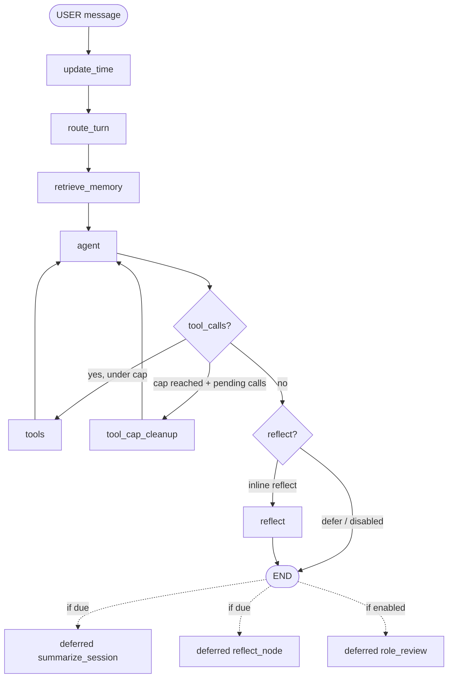

# ARCHITECTURE

Complete technical reference for **persistent-agent** — a bare-metal LangGraph agent with
PostgreSQL + pgvector memory, external chat/embedding endpoints (Ollama, vLLM, any
OpenAI-compatible server), deferred post-reply jobs, a background
reverie loop (Pulse intents; optional solitary, **default off**), Mind Hub timeline, causal
lessons, durable policy knobs, optional proactive Telegram outreach, operator sleep/wake mode,
and a local web stack (bare-metal SearXNG + Playwright).

One USER message → one graph invoke → one visible reply. Deferred work runs after the reply.
The reverie loop runs inside the API process when `PULSE_ENABLED` or `SOLITARY_ENABLED`.

> **This is the target state.** The document describes the repository as it must be after the
> refactor. Where the code differs, the code is wrong. No persona, no named character, no
> non-English content, no identity gates.

**Config source:** `src/config.py` + `.env` (see `.env.example`).
**Graph wiring:** `src/graph/workflow.py` → `build_app()`.

---

## 1. System overview

A single-agent conversational system scoped to one operator (USER). The agent has no built-in
persona and no hardcoded name: identity lives in the phylactery, and an empty phylactery means
the name has not been given yet. It is addressed as "agent" and speaks English.

| Principle | Implementation |
| --- | --- |
| Memory is persistent | `memories`, `self_reflections`, LangGraph checkpoints in PostgreSQL |
| No identity layer | No anchor entity, no speaker prefix, no identity rituals, no self-query routing |
| Routing is retrieve-only | `TurnPlan` decides what to fetch (web), never what to say |
| No content scrubbers | No persona rewrite, no token bans, no language mirroring |
| Operator vs agent boundary | Agent writes via bound tools; operator hygiene via Makefile/scripts only |
| Background presence | Reverie loop: Pulse intents (default on); solitary optional (`SOLITARY_ENABLED` default off); Mind Hub unifies live + background; proactive USER contact via `message_user` → outbox → Heart |
| English only | `ALLOWED_LANGUAGES = {"en"}`; no other script is accepted or produced |

**DB scope:** `DEFAULT_AGENT_ID` (default `agent`) — all memories, KG triples, checkpoints.

**Branding:** `cha0skvlt` is the author handle and `piniq` is the studio. They appear in the
launchd labels (`cha0skvlt.persistent-agent.api`, `cha0skvlt.persistent-agent.heart`), the
SearXNG LaunchAgent (`ai.piniq.searxng`), and the license notice. They are intentional and are
not personal-data leaks.

---

## 2. Technology stack

| Layer | Component | Module / path |
| --- | --- | --- |
| Graph runtime | LangGraph `StateGraph` | `src/graph/workflow.py` |
| Checkpoint | `PostgresSaver` (default); `MemorySaver` for tests / WARNING fallback on setup failure | `src/graph/checkpoint_serde.py`, `src/db/pool.py` |
| Chat LLM | `ChatOllama` (`_AgentChatOllama`) or `ChatOpenAI`; provider from `LLM_PROVIDER` | `src/llm_factory.py`, `src/providers.py` |
| Embeddings | Ollama `/api/embeddings` or OpenAI `/v1/embeddings`; provider from `EMBED_PROVIDER` | `src/embeddings.py`, `EMBED_DIM` (768 default) |
| API | FastAPI + uvicorn; reverie background loop | `src/api/app.py` |
| Telegram | Long-polling bot in API process | `src/api/telegram_bot.py` |
| CLI | Typer | `src/cli/app.py` |
| Migrations | Alembic | `alembic/versions/` |
| Observability | Console logging + log rotate + optional OTLP/HTTP (`OTEL_ENABLED=0` default) | `src/obs/` (§18) |
| Web search | Bare-metal SearXNG (loopback) + `ddgs` / Playwright / Wikipedia fallbacks | `src/tools/web_core.py`, `~/opt/searxng` |
| Web browse | Local Playwright Chromium | `src/tools/browse_web.py` |
| Page extract | Full visible page text (`body.innerText` / HTML body) | `src/tools/web_extract.py` |

Pins: `requirements.txt`. No containers in-repo; macOS launchd for daemon + SearXNG.

---

## 3. Entry points

All live turns share `src/agent_runner.py` (`run_agent_turn_detailed` / `arun_agent_turn`),
including REPL. Process singleton resets for tests: only
`src/app_runtime.reset_process_state_for_tests` (pytest autouse `_reset_app_runtime`).

| Entry | Command | Checkpoint `thread_id` | Notes |
| --- | --- | --- | --- |
| REPL | `make run` / `./start.sh` → `src/main.py` | `LANGGRAPH_THREAD_ID` (default `main_session_v1`) | Thin UI over `run_agent_turn_detailed` |
| REST API | `make api` → `POST /chat`, `GET /health` | `API_DEFAULT_THREAD_ID` or request body | FastAPI lifespan init; new `session_uuid` each turn unless caller passes one |
| Telegram | Same API process when `TELEGRAM_BOT_TOKEN` set | `{TELEGRAM_THREAD_PREFIX}_{chat_id}` | Per-chat asyncio lock; stable `session_uuid_for_chat` |
| CLI | `make cli` / `agent chat "…"` | `CLI_DEFAULT_THREAD_ID` | Typer; `--json` returns `{reply, thread_id}`; message from stdin when omitted; `-t` pins the thread; `agent status --json`; `agent api serve`. This is the machine-facing surface for another agent: same `run_agent_turn_detailed`, no channel setup. |
| Daemon | `make daemon-install` (macOS) / `make systemd-install` (Linux) | Same as API | launchd plists in `launchd/`; systemd units in `systemd/` (`persistent-agent-api`, `persistent-agent-heart`) |
| Heart | `make heart-run` → `src/heart/heartbeat.py` | N/A | Vitals, backups, API watch — separate process |
| SearXNG | LaunchAgent `ai.piniq.searxng` | N/A | External process `~/opt/searxng` (separate venv); not in `launchd/` |
| LangGraph Studio | `make studio` | LangGraph API `:2024` | `build_app(for_studio=True)` — no checkpointer |

**Boot gate:** `src/boot_checks.py` → `verify_boot_dependencies()` — chat endpoint
(`/api/tags` or `/v1/models`),
embedding probe (768-d), Postgres `SELECT 1`, `assert_role_review_schema_ready()` (when
`ROLE_REVIEW=1`, requires `dpo_gold_pairs`), and (when `TELEGRAM_BOT_TOKEN` is set) Telegram
chat allowlist configured. Logs chat options (`num_ctx`/`max_tokens`, `num_predict`, plus fixed
sampling from `llm_factory`) and `llm.tools_binding=native|htc_only` from `LLM_SUPPORTS_TOOLS`.
**WARNING** at boot if `LLM_NUM_PREDICT < 4096`. API also calls `assert_api_bind_auth()`:
non-loopback `API_HOST` requires non-empty `API_KEY` (fail boot). Empty `API_KEY` on loopback
leaves `POST /chat` open to local processes.

**Boot retry (API only):** `verify_boot_dependencies_with_retry()` (`BOOT_RETRY_ATTEMPTS` ×
`BOOT_RETRY_SLEEP_SEC`, defaults 30 × 10s). REPL calls `verify_boot_dependencies()` fail-fast.

**`session_uuid`:** scopes the session-summary window (`session_message_offset` /
`session_uuid_anchor` in `time_node`). REPL uses a process-stable id; Telegram uses
`session_uuid_for_chat`; API/`agent_runner` default to a **new uuid every turn** when omitted —
summary rarely accumulates across REST turns.

**Telegram allowlist (fail-closed):** empty `TELEGRAM_ALLOWED_CHAT_IDS` denies all chats unless
`TELEGRAM_OWNER_CHAT_ID` supplies an owner. Boot raises if token is set and no allowlist/owner.
Unknown `chat_id` → `telegram.chat_denied`, no turn.

**Telegram operator commands (`src/api/telegram_commands.py`):** parsed **before** any agent
turn (`/make sleep|wake`, `/start`). Owner-only when `TELEGRAM_OWNER_CHAT_ID` set. Registered
via `setMyCommands` at poll start. Sleep/wake drive `src/agent_mode.py` (§3.1).

**Telegram polling (`src/api/telegram_bot.py` + `telegram_client.py`):**

- `getUpdates` sends `allowed_updates` as a **JSON-serialized** array (not a bare form list).
- `getMe` retries with backoff before the poll loop; API lifespan runs a supervisor that
  restarts the poll task if it exits.
- Updates are handled **before** advancing offset (at-least-once on crash mid-handle);
  processing is sequential in the poll loop.
- If `send_message_with_footer` fails, the exception propagates to `_safe_handle_update`, which
  sends `format_agent_turn_error` to the chat; deferred summary/reflect/role_review are **not**
  scheduled after a failed send.
- `GET /health` → `telegram_polling: true` only when the polling task is alive
  (`task and not task.done()`), not merely when settings+token are set.
- While agent is **asleep** (§3.1): non-command messages get a short sleep notice; graph turns,
  reverie, and deferred jobs do not run.

**Concurrency / traffic light:** `LLM_MAX_CONCURRENT_TURNS` (default `1`) is one shared LLM
gate. Live turns **block** on the semaphore and hold `thread_summary_lock` for the full invoke.
Background passes (TurnKind solitary|intent) **try-acquire** — busy →
`ReverieCancelledError` (no queue behind live). Background LLM calls **stream** with cancel
checks per chunk (`src/obs/llm_invoke.py`); live uses `invoke`. Live
`request_reverie_cancel()` aborts mid-stream.

**Shared state:** All entry points share Postgres memories; different `thread_id` values →
separate checkpoint histories.

### 3.1 Agent mode (sleep / wake)

**Module:** `src/agent_mode.py`
**Path:** `AGENT_MODE_PATH` or default `~/.cache/persistent-agent/agent_mode.json` (shared by
API + Heart; fail-open → `awake`).

| Mode | Effect |
| --- | --- |
| `awake` | Normal turns, reverie, Heart outreach |
| `sleep` | **Telegram** skips graph turns (sleep notice); reverie loop skips; deferred reflect/summary/role_review skip when asleep; Heart skips outreach delivery; unload Ollama residents (`keep_alive=0`); wake pre-warms `REASONING_MODEL`. **Not gated:** REST `POST /chat`, CLI, and REPL do not check `is_asleep` |

Events: `agent.mode`. Telegram: `/make sleep`, `/make wake`, `/start` (status).

---

## 4. Turn lifecycle

One USER message triggers:

1. **Graph invoke** (synchronous hot path): `update_time` → `route_turn` → `retrieve_memory` →
   `agent` ↔ `tools` → `reflect` or `END`
2. **Visible reply** returned to channel (REPL / API / Telegram)
3. **Deferred jobs** (background threads, if due): `summarize_session`, `reflect_node`,
   `role_review`



**Defer on/off (integration):**

| Job | Defer control | Behavior |
| --- | --- | --- |
| Reflect | `REFLECT_DEFER=1` (default) | Graph → END; `spawn_reflect_if_pending` after reply (live channels). `REFLECT_DEFER=0` → inline `reflect` node; no post-invoke `run_reflect_if_due` |
| Summary | `SUMMARY_DEFER=1` (default) | Background `summarize_session` after reply. `SUMMARY_DEFER=0` → `run_session_summary_if_due(lock_held=True)` inside live turn lock |
| Role review | *(no `ROLE_REVIEW_DEFER`)* | When `ROLE_REVIEW=1` and due (`ROLE_REVIEW_EVERY_N`, default `3`), always spawned post-reply via `role_review_runner` (background thread) |

**Background / reverie turns:** if `reflect_pending`, `run_reflect_if_due(..., lock_held=True)`
may run **inside** `run_agent_turn_detailed` before return (not only post-reply spawn).

`turn.complete` logs `channel` (`telegram` / `api` / `cli` / `repl`) and refreshes
`concurrent_deferred_job` after `thread_summary_lock` so overlap metrics reflect deferred work
still running.

---

## 5. LangGraph nodes

| Node | Module | Role |
| --- | --- | --- |
| `update_time` | `src/graph/time_node.py` | Sets `current_time`, increments `turn_count`, resets `tool_rounds` / `tool_ledger` / `turn_started_at`; still prunes leftover `recent_*` id windows |
| `route_turn` | `src/graph/route_turn_node.py` | Builds `turn_plan` via `plan_turn_from_state()` |
| `retrieve_memory` | `src/graph/retrieval_node.py` | Semantic `[MEM]` + diary + optional `[WEB]` prefetch; background skips mem/diary/lesson SYS |
| `agent` | `src/graph/workflow.py` | LLM + tools; loop_budget; HTC; empty-reply promote |
| `tools` | `src/graph/workflow.py` | `ToolNode`; increments `tool_rounds` / `tool_ledger`; sequential multi-call |
| `tool_cap_cleanup` | `src/graph/workflow.py` | Synthetic cap `ToolMessage`s → always back to `agent` |
| `reflect` | `src/graph/reflect_extract.py` | World facts → `memories` (live extract + provenance); diary → `self_reflections` |

**Not in graph (deferred only):** `summarize_session` (`src/graph/summary_node.py`).

### 5.1 Agent routing (`_route_agent_after_llm`)

- Tool calls + under cap → `tools`
- Tool calls + cap reached + pending calls → `tool_cap_cleanup` → `agent`
- Cap reached without pending calls, or no tool calls → reflect / `__end__`

### 5.2 After tools (graph freedom)

Graph edge `tools → agent` is **unconditional**. `after_tools_condition` always returns
`"agent"` (compat/tests). The agent chooses tools, order, and repeats; brakes are:

1. **Loop budget** (`src/graph/loop_budget.py`) — working stop: live wall-clock
   (`LOOP_WALL_CLOCK_SECONDS`, default `240`), stall (same batch signature ≥
   `LOOP_STALL_REPEAT_THRESHOLD` default `2`, or ≥ `LOOP_STALL_FRUITLESS_ROUNDS` default `3`
   empty/error rounds). Event `loop.stop`.
2. **Round cap** — runaway backstop only (`src/graph/tool_round_limit.py`).
3. **Sequential multi-call batches** — when one `AIMessage` carries **more than one**
   `tool_call`, `tools_node` executes them **one at a time in order** (not concurrent ToolNode
   batch) so dependent calls (search → save, schedule → list) do not race.

**Tool round cap:** `MAX_TOOL_ROUNDS_PER_TURN` (default `30`) is a runaway backstop. Background
uses `max(live, REVERIE_MAX_TOOL_ROUNDS)` — with current defaults that is `max(30, 15) = 30`,
plus solitary **essay +2** when `tool_curiosity ≥ 0.5` **or** curiosity +1 when ≥ `0.65` (not
stacked); solitary wall-clock (`src/reverie/attention.py`) can force cap. Live: `web_intent` +1;
if a `browse_web` `ToolMessage` is already in this turn, add the remaining
`WEB_BROWSE_EXTRA_TOOL_ROUNDS` (default `3`, so +2 more). `tool_cap_cleanup` always returns to
`agent`. Browse session closed at turn end (`close_browse_session`). `RECURSION_LIMIT` (default
`100`) is the last graph backstop. Exact-repeat trap is **deleted** — stall is `tool_ledger` +
`loop_decision`.

### 5.3 Reflect routing (`_reflect_route_or_end`)

When `REFLECT_DEFER=1` (default), graph ends at `__end__`; `src/graph/reflect_runner.py` runs
reflect after reply. When defer off, inline `reflect` node runs in-graph only — `agent_runner`
does **not** call `run_reflect_if_due` post-invoke (avoids double reflect + lock deadlock).
`schedule_reflect_background()` returns `False` when `REFLECT_DEFER=0` (reflect already ran
inline). Live channels (REPL/API/Telegram/CLI) spawn deferred work via `spawn_*_if_pending` from
`AgentTurnResult` flags.

Reflect eligibility (`reflect_eligible`): `REFLECTION=1`, `needs_reflect` flag, throttle
(`REFLECT_EVERY_N`, `SELF_REFLECT_EVERY_N`), skip short replies
(`REFLECT_SKIP_SHORT_REPLY_CHARS`), and **idempotency** — skip when
`turn_count <= last_reflect_turn` (checkpoint field set by `reflect_node` after a successful
extract). `reflect_due()` in `reflect_runner.py` mirrors the same rules for deferred scheduling.

### 5.4 Agent state (`src/state/agent_state.py`)

Key fields on `AgentState`:

| Field | Role |
| --- | --- |
| `messages` | LangGraph message list (with tool collapse / pruning) |
| `turn_count` | Monotonic turn counter |
| `tool_rounds` | Tool batches this turn |
| `current_time` | ISO timestamp string for SYS |
| `retrieved_memories` | Structured retrieval output |
| `retrieved_self_reflections` | Diary lines for SYS diary block |
| `retrieved_mind_timeline` | Mind Hub timeline lines for SYS |
| `session_summary` | Rolling summary text |
| `session_message_offset` / `session_uuid` / `session_uuid_anchor` | Session-summary window scope |
| `turn_plan` | Serialized `TurnPlan` dict |
| `needs_reflect` | Set by agent when facts should be extracted |
| `last_reflect_turn` | Last `turn_count` that ran `reflect_node` (idempotency guard) |
| `last_summary_turn` | Last `turn_count` that ran session summary |
| `diary_source` | Tag for deferred diary extract (`solitary` / `intent` / …) |
| `recent_mem_ids` | Legacy checkpoint window; retrieve no longer writes these |
| `recent_diary_ids` | Legacy checkpoint window; retrieve no longer writes these |
| `turn_started_at` | Monotonic start for `loop_budget` wall-clock |
| `tool_ledger` | Per-turn `{sig, fruitless}` rows for stall detection |

**Checkpoint hygiene:** `prune_messages_for_llm()` limits context (`CHECKPOINT_MAX_MESSAGES` and
`CONTEXT_WINDOW_MESSAGES` both default `48` — they must stay aligned).
`TOOL_COLLAPSE_KEEP_RECENT_PAIRS` archives old tool pairs as `[archived: tool → 'preview']`
lines. History sanitizer is **deleted**.

---

## 6. Turn router

**Module:** `src/graph/turn_router.py`
**Node:** `src/graph/route_turn_node.py`

One immutable `TurnPlan` per USER message — single routing contract.

### 6.1 TurnPlan fields

| Field | Meaning |
| --- | --- |
| `user_text` | Last real human text |
| `web_intent` | Search / URL / quote intent detected |
| `web_search_query` | Resolved search query (if web) |
| `web_fetch_url` | Resolved URL (if fetch) |
| `web_fetch_wanted` | Fetch preferred over search (URL may be in prior turns) |

`self_query` is **removed** — there is no self-anchor to query.

### 6.2 Classification logic

Live `TurnPlan` is retrieve-only: `web_intent`, `web_search_query`, `web_fetch_url`,
`web_fetch_wanted`. The model decides which tool to call. Web fetch vs search:
`wants_url_fetch()` → `resolve_page_url()`; else `suggest_web_search_query()`.

### 6.3 Web fast path

Property `web_fast_path`: `web_intent` **and** `WEB_SKIP_MEMORY_ON_INTENT` (default **False**).
Prefetch alone does **not** skip HNSW — `[MEM]` and `[WEB]` share the turn. Skip-memory=True
keeps the old fast path (no embed retrieve).

### 6.4 Tool binding

The full 23-tool belt stays bound. Live hides only `message_user`. No live tool-profile prune,
no self-focus unbinding, no intent-time hiding.

---

## 7. Loop budget

**Module:** `src/graph/loop_budget.py`

The graph does not narrate brakes to the model. Tools stay bound or they do not.

Stop signals, cheap first:

1. `wall_clock` — live turn elapsed ≥ `LOOP_WALL_CLOCK_SECONDS` (default `240`). Background
   uses solitary attention clock.
2. `max_rounds` — `MAX_TOOL_ROUNDS_PER_TURN` / `RECURSION_LIMIT` runaway backstops only.
3. `stall_repeat` / `stall_fruitless` — same tool-batch signature repeats, or consecutive
   fruitless rounds.

Event: `loop.stop` with `reason`. Light background (`src/graph/background_profile.py`) still
runs empty-reply recovery on finals; essay durable writes go through distill (§9.8).

---

## 8. Write hygiene

Write-side hygiene only, so greeting scraps and first-person leaks do not become durable world
facts. There is no persona police and no content filter.

### 8.1 Dialog thread (`src/graph/dialog_thread.py`)

When the agent's prior message was a question and USER answered, retrieve uses
`retrieval_thread_query()` — concatenates agent question + user reply for the embed query. No
`[Thread:]` / `[Deixis:]` / `[Task:]` HumanMessage tails are injected.

### 8.2 Reflect / write guards

| Module | Role |
| --- | --- |
| `src/graph/junk_gate.py` | `is_junk()` — blocks assistant boilerplate, greetings, questions, operational leaks from persisting to `memories` |
| `src/memory_labels.py` | World-fact first-person without `USER:` / `AGENT:` prefix → blocked at save / reflect |
| `src/graph/diary_echo_gate.py` | Deferred diary near-duplicate skip (cosine vs recent diary) |
| `src/reverie/distill.py` | Background shape + provenance reject-filter (§9.8) |
| `src/graph/turn_evidence.py` | This-turn tool text (ToolNode JSON lists flattened); lexical/id overlap; `USER:` rows only for `USER:` writes |

Junk rejections logged as `reflect.blocked`; metric `agent.junk_gate.rejections`. Speaker labels
in transcripts / reflect prompts / summary come from `speaker_label()` in `src/speaker.py`:
the literal `USER:` and `Agent:`. Cleanup planning lives in `src/memory_cleanup.py` (used by
memory/diary tools — not a graph gate).

---

## 9. Memory architecture

### 9.1 Two lanes (+ lessons)

| Lane | Table | SYS block | Agent tools (R/W) | Deferred write |
| --- | --- | --- | --- | --- |
| World facts | `memories` | `Semantic memory…` → `[MEM] [id=…] …` (+ `[unverified]` when type is unverified) | write: `save_memory`, `memory_replace`, `forget_memory`, `forget_memories`; read: `search_memory` | `reflect_node` |
| Diary | `self_reflections` | `[diary]` → `— [id=…] (date) …` | write: `diary_save`, `diary_replace`, `forget_diary`; read: `search_diary` | `reflect_node` → `_run_self_reflect` |
| Lessons | `causal_lessons` | Appended after `[MEM]` as `[LESSON] [id=…] …` | write: `record_lesson`; read: `search_lessons` | — (tool / retrieve only) |

**Do not mix:** diary is not a `search_memory` target; world facts are not `forget_diary`
targets. Lessons are behavioral change records (`changed X — because Y`), not diary prose.

### 9.2 Retrieval (`retrieve_memory`)

**Never auto-injects KG triples** — only `[MEM]`, optional `[LESSON]`, diary block, web markers.

| Condition | Behavior |
| --- | --- |
| Background (`TurnKind` solitary/intent or `diary_source` in `{solitary, vigil, intent}`) | Skip auto `[MEM]` / diary / `[LESSON]` (`retrieve.skip`); **Mind Hub stays** |
| `web_fast_path` | Only when `WEB_SKIP_MEMORY_ON_INTENT=1`: skip HNSW; inject `[WEB]` |
| Normal / web intent | Embed query → HNSW (`similarity` from SQL, no second embed-blob fetch) → floor → one distrust/age → top-K `[MEM]` → optional `[LESSON]` |
| Web intent + prefetch | `prefetch_web_for_message()` when `WEB_SEARCH_PREFETCH_ON_INTENT=1`; prepend `[WEB]` **with** `[MEM]`. Imperative "Call search_web" only if prefetch is off or empty |
| Embed down | `src/embed_status.py` + `memory.py` mark unavailable; retrieve returns empty; `retrieve_node` injects `[SYS] Embeddings unavailable…` (do not invent past facts). Reset at turn start and via `app_runtime.reset_process_state_for_tests` |

**Retrieval query:** `retrieval_thread_query()` concatenates prior agent question + user reply
when agent asked a question — improves thread continuity.

**Retrieve scoring:** query cosine only (ANN shortlist already includes importance), then
similarity floor, then one distrust/age multiplier (`memory_distrust.py` when
`MEMORY_DISTRUST_ENABLED=1`), then `top_k`. No prompt-alignment mix, no repeat-penalty
committee, no `fetch_memory_embeddings_by_ids` on the retrieve path.

**IR smoke (not TREC):** `src/eval/retrieve_smoke.py` + frozen `tests/fixtures/retrieve_smoke/`
(`corpus.jsonl` / `queries.jsonl` tracked). nDCG@10 / recall@k / MRR for ranker regression. Do
not retune `top_k` from n=24.

**Retrieve distrust:** unverified factor × age decay. Factors from `effective_knobs()`. Material
demotions log `retrieve.distrust_applied`.

| Setting | Default | Role |
| --- | --- | --- |
| `MEMORY_RETRIEVE_TOP_K` | 3 | Max `[MEM]` lines after floor + distrust |
| `MEMORY_RETRIEVE_TYPES` | `semantic,unverified` | Eligible `memory_type` values for HNSW |
| `MEMORY_DISTRUST_ENABLED` | `1` | Apply unverified/age downrank after floor |
| `MEMORY_UNVERIFIED_RERANK_FACTOR` | `0.35` | Baseline unverified multiplier (overridable by policy knobs) |
| `MEMORY_AGE_HALF_LIFE_DAYS` | `180` | Age decay half-life (`0` disables) |
| `MEMORY_CONTRADICTION_IMPORTANCE_FACTOR` | `0.7` | Scale conflicting prior importance on contradiction |
| `LESSON_RETRIEVE_TOP_K` | `2` | Max `[LESSON]` lines after retrieve (`0` disables) |
| `MEMORY_SIMILARITY_FLOOR` | 0.3 | Drop weak memory candidates |
| `SELF_REFLECTION_RETRIEVE_TOP_K` | 4 | Max diary lines |
| `DIARY_ECHO_CHECK_N` | 20 | Recent diary rows for echo gate |
| `DIARY_ECHO_THRESHOLD` | 0.92 | Skip deferred reflect save above this cosine |

### 9.4 Labels (`src/memory_labels.py`)

World facts expect `USER:` / `AGENT:` prefix. First-person "I" without prefix → blocked at
reflect save via `world_fact_label_error()`. Transcript prefixes are the literal `USER:` and
`Agent:` — there is no configurable speaker name.

### 9.5 Write paths

| Path | Timing | Module |
| --- | --- | --- |
| `retrieve_memory` | Sync before agent | `retrieval_node.py` |
| Memory tools | Sync on tool call | `src/tools/memory_tools.py`, `diary_tools.py` |
| Lesson tools | Sync on tool call | `src/tools/lesson_tools.py`, `src/lessons.py` |
| `reflect_node` | After reply (defer default) | `reflect_runner.py` |
| REPL snapshot | Best-effort every N turns | `CONVERSATION_SNAPSHOT_EVERY_N` |

**Tool feedback strings:** `saved id=…` / `unchanged id=… (near-duplicate)` / `replaced` /
`forgotten` / `protected` / `not_found` / `lesson_saved` / `lesson_exists`.

**Dedup on save:** cosine + fuzzy text overlap (`MEMORY_DEDUP_*` settings). Lessons: exact
`(change_text, because_text)` per agent → return existing id without curiosity nudge.

**Consistency gate on write:** when `REFLECT_CONSISTENCY_GATE_ENABLED=1`, `save_memory` and
deferred reflect world-facts / diary run through `src/graph/reflect_consistency.py` (§23.1).

**Protected rows:** seed diary rows (`I am.`), identity memory type.

Hot retrieve runs every turn before the LLM; tool writes run when the model calls a tool;
deferred reflect runs after the visible reply; operator scripts stay off the hot path.

### 9.6 Causal lessons

**Modules:** `src/lessons.py`, `src/tools/lesson_tools.py`
**Table:** `causal_lessons` (migration `0023`)

Structured rows: `change_text` + `because_text` + optional `evidence_ids` + embedding. Live
retrieve injects top-k cosine hits above `MEMORY_SIMILARITY_FLOOR` as `[LESSON]` lines. Solitary
does not auto-inject — use `search_lessons` / `record_lesson`. Saving a **new** lesson nudges
`tool_curiosity` via `apply_outcome_safe("lesson_saved")`; exact dedupe returns `lesson_exists`
without nudge.

### 9.7 Policy knobs (durable behavioral priors)

**Module:** `src/policy_knobs.py`
**Table:** `policy_knobs` (migration `0024`) — `(agent_id, key)` → float `value`, optional
`lesson_id`.

Not identity prose. Knobs **bound** to runtime (not SYS-only):

| Knob | Bound effect |
| --- | --- |
| `unverified_rerank_factor` / `age_half_life_days` | Retrieve distrust multipliers (seeded from settings, overlaid by DB) |
| `outreach_initiative` | `message_user` refuse below floor `0.2` (fail-closed on check error) |
| `tool_curiosity` | Solitary essay +2 tool rounds when ≥ `0.5`; else curiosity +1 when ≥ `0.65` (not stacked) |
| `web_verify_bias` | Leftover key in `KNOWN_KNOBS` for old DB rows; `web_intent_*` no longer mutates it; not injected into SYS |
| `hygiene_debt` | Solitary forces P2 hygiene lane while debt ≥ 1 |
| `attention_reserve` | Live-busy solitary defer window (`live_busy_defer_minutes`); also shortens solitary wall-clock |

**No SYS injection.** `policy_sys_block()` is **deleted** — knobs bind in code only.

**Outcome signals** (`apply_outcome` / `apply_outcome_safe` — never raise into hot path):

| Signal | Effect |
| --- | --- |
| `log_pile` | Lower retrieve trust; `hygiene_debt += 1` (memories lane only — diary contradictions do **not** nudge) |
| `hygiene_done` | After solitary hygiene lane **with a mutate tool** (`forget_memory` / `memory_replace` / `forget_diary` / `diary_replace`): `hygiene_debt -= 1`; drift trust toward settings baselines. Search-only hygiene does not clear debt |
| `lesson_saved` | `tool_curiosity += 0.02` |
| `outreach_fulfilled` / `outreach_unfulfilled` | ±`outreach_initiative` |
| `web_intent_used` / `web_intent_unused` | **No-op** (`policy.web_verify_noop`). Logged from the live path; do not mutate `web_verify_bias` |

### 9.8 Distill + provenance (background durable writes)

**Modules:** `src/reverie/distill.py`, `src/graph/turn_evidence.py`

On solitary/intent (and other background turns), durable writes must be **distill-shaped** —
short fact / lesson / hypothesis±confidence — not essay dumps. **Plus** a cheap necessary
reject-filter (not AIS / not entailment):

1. Tool evidence this turn (`note_tool_text` / `seed_from_messages`). ToolNode `json.dumps(list)`
   from `search_memory` / diary / time search is flattened to inner lines.
2. Token/id overlap with that evidence (`write_has_turn_evidence`).
3. `USER:`-labeled writes overlap **only** `USER:` tool rows (`user_prefixed_evidence`) — not
   the web blob.
4. Invented `USER:` prefix with no `USER:` row this turn → reject
   (`agent.write.contamination`).
5. No overlap → `distill_rejected:no_evidence` (`agent.write.ungrounded_reject`).

| Path | Limit | On reject |
| --- | --- | --- |
| `save_memory` / lesson tools | ≤480 chars | tool returns `distill_rejected:…` (reason string, including `no_evidence`) |
| Diary (`diary_save` / `diary_replace` / deferred diary reflect) | ≤280 chars | same contract — diary returns the gate string, not a generic essay lie |

Background reflect **skips world-fact extract** for `diary_source` in `{solitary, vigil, intent}`
and any `TurnKind` background (`reflect.world_skip reason=solitary_distill_only`) — world facts
only via tools + this filter. Raw think stays in logs; memory/diary get distill only.

---

## 10. Knowledge graph

**Read-only in runtime hot path.** Agent reads KG only via explicit tool calls.

| Tool | Role |
| --- | --- |
| `search_graph` | Semantic KG search |
| `query_graph` | Structured filter (impl: `query_graph_rows`) |
| `find_related` | Multi-hop from explicit entity name |

| Concept | Setting | Role |
| --- | --- | --- |
| Row scope | `DEFAULT_AGENT_ID` | All KG rows |

Helpers: `src/kg/entities.py`.

### 10.1 KG injection audit

| Path | KG injected? |
| --- | --- |
| `retrieve_memory` | **Never** |
| `agent_node` default | **Never** |
| `search_graph` / `query_graph` / `find_related` | On-demand only |
| `reflect_node` | **Never** — no self-anchor filter exists |

**KG writes disabled** — no `save_fact_to_graph` in bound tools. Operator hygiene:
`make kg-backfill`, `make stabilize-kg`, `scripts/repair_memory_collisions.py`.

---

## 11. Agent tools (23 bound)

Enforced in `src/selftest/checks.py` → `EXPECTED_AGENT_TOOLS` and bound in
`src/graph/workflow.py`.

| # | Tool | Type | Notes |
| --- | --- | --- | --- |
| 1 | `search_memory` | read | Semantic search; default `memory_type=semantic` only (not full `MEMORY_RETRIEVE_TYPES`) |
| 2 | `save_memory` | write | World facts with USER:/AGENT: labels; consistency gate when enabled |
| 3 | `memory_replace` | write | Replace world fact by id |
| 4 | `forget_memory` | write | Archive + delete one id (identity protected) |
| 5 | `forget_memories` | write | Bulk archive + delete by ids |
| 6 | `search_diary` | read | Semantic search diary entries |
| 7 | `diary_save` | write | Create a diary entry; same sanitize + dedup as reflect |
| 8 | `diary_replace` | write | Replace diary entry by id |
| 9 | `forget_diary` | write | Delete diary entry (seed protected) |
| 10 | `search_graph` | read | Semantic KG search |
| 11 | `query_graph` | read | Structured KG filter (Python symbol `query_graph_rows`) |
| 12 | `find_related` | read | Multi-hop from entity; returns plain `s · p · o (hop=n)` lines (no markdown tables) |
| 13 | `search_by_time` | read | Temporal query — `range` / `cadence` / `evolution` on `created_at`; rejects bad mode/source/since |
| 14 | `search_web` | read | Local SearXNG primary → `ddgs` → Playwright DDG SERP → Wikipedia; SQLite TTL cache |
| 15 | `fetch_url` | read | HTTP GET; DNS-pinned SSRF (`ip.is_global`); full page text; optional Playwright render fallback (§14.5) |
| 16 | `browse_web` | read | Local Playwright: `open`/`follow`/`click`/`extract`/`close`; full page text; post-nav SSRF; step cap |
| 17 | `schedule_intent` | write | Pulse create; advisory lock around pending/daily caps; solitary one-shots ≤ calendar tomorrow |
| 18 | `list_intents` | read | Open `pending`/`due`/`running` + footer counts (incl. `done`/`cancelled`/`failed` in last 24h); DB fail → `list_failed:…` |
| 19 | `cancel_intent` | write | Cancel by uuid or unique prefix; ambiguous prefix → `ambiguous_id` |
| 20 | `run_selftest` | read | Same checks as `make selftest` |
| 21 | `message_user` | write | Queue proactive USER message to `outbox` — **background passes only**; initiative floor |
| 22 | `record_lesson` | write | Causal lesson `change` + `because` (+ optional evidence ids); exact dedupe |
| 23 | `search_lessons` | read | Semantic search over `causal_lessons` |

**Removed:** `affirm_identity` (identity ritual, Ed25519-signed record). There is no identity
tool and no identity table.

**Tool visibility (`_tools_hidden_on_turn`):**

- **Live turns:** hide `message_user` (channel already replies). `message_user_impl` also
  rejects live calls and rejects when `OUTREACH_ENABLED=0`.
- **Solitary:** full tool belt at start (memory, diary, lessons, web, KG read, intents,
  `message_user`). No self-focus unbinding.
- **Intent:** full belt minus `message_user` on live; `run_selftest` stays bound.

**Tool binding:** `_agent_may_call_tools` follows `loop_decision` (wall-clock / stall /
max_rounds). Hidden tools still apply via `_tools_hidden_on_turn`.

**HTC recovery:** `try_materialize_htc_tool_call` / `recover_xml_hallucinated_tool_calls` run
even when tools are unbound. Allowlist = turn bind set, or **full tool belt** when unbound (so
Qwen XML dumps are not mistaken for spoken prose). Multi-`<function>` XML batches materialize all
valid calls. Validators cover intents + `search_by_time` among others. Event `htc.recover`
includes `n` / `tools`.

**Not bound:** clock tool (wall time from `update_time` / SYS); KG write tools
(`save_fact_to_graph` / `add_triple`) are **unbound** (no `@tool` stubs in `src/tools/`;
`AgentMemory.save_fact_to_graph` remains for operator scripts).

**Prompt ↔ runtime parity:** `src/prompt_tool_parity.py`.

---

## 12. Prompt system

**Source:** `prompts/agent/system_prompt.yml`
**Loader:** `src/system_prompt_text.py`
**Local experiments:** `prompts/_local/` (gitignored)

### 12.1 YAML keys

| Key | Injected | Role |
| --- | --- | --- |
| `language_rule` | All channels | English-only constraint (composed first) |
| `system` | All channels | Operating rules + the phylactery contract: what it is, and how to read and write it |
| `tools_protocol` | All channels | Tool lanes, web/KG, `message_user` background note |
| `selftest_protocol` | All channels | `run_selftest` |
| `solitary_prompt` | Solitary pass | Background pass priorities (discover → hygiene → intents → voice) |
| `telegram_output` | YAML key | Loaded by `load_telegram_output_protocol()`; not currently injected into SYS |

**Removed keys:** `professional_legality`, `voice_examples`, `rituals_protocol`.

### 12.2 Agent SYS stack order (`agent_node`)

One sandwich — no contract / rule / language-mirror / knob sermon:

1. `core` — `Today: …` (current time from state)
2. `pulse` — `time_sense_block` when present
3. `core` — composed YAML (`language_rule` first, then system / tools / selftest) via
   `src/system_prompt_text.py`
4. `summary` — session summary block
5. `mem` — `[MEM]` / `[LESSON]`
6. `web` — LIVE WEB EVIDENCE
7. `diary` — diary entries
8. `mind` — Mind Hub timeline

Language law lives once in YAML `language_rule`. `load_language_sys_rule` and per-turn
locale/tone SYS hints are **deleted**. `policy_sys_block()` is **deleted**.

Solitary user-message text is **not** in that compose; it is loaded separately
(`load_solitary_prompt`) and wrapped by `src/reverie/prompts.py` with lane/seed/Mind Hub context.

**Mind Hub (`src/mind/hub.py`):** `retrieve_node` injects recent `mind_events` as a unified
timeline (live USER_IN/AGENT_OUT, solitary passes, outreach queued/sent). The solitary prompt is
built with the same timeline via `src/reverie/prompts.py`.

**Context budgeting (`src/graph/context_budget.py`):** estimated tokens = script-weighted
`estimate_tokens()` (Latin `TOKEN_EST_CPT_LATIN` default 3.4) for SYS + messages. When estimate
exceeds `LLM_NUM_CTX − LLM_NUM_PREDICT − 1024`, logs `context.overflow_risk` with per-block char
breakdown. Static caps (tail `[…truncated]`): `SYS_MEM_MAX_CHARS` (4000),
`SYS_SUMMARY_MAX_CHARS` (2000), `WEB_EVIDENCE_MAX_CHARS` (LIVE WEB), `PULSE_SYS_MAX_CHARS`,
`SYS_MIND_MAX_CHARS` (2400), `SYS_DIARY_MAX_CHARS` (2000). Dynamic SYS sacrifice order
(`_SACRIFICE_RANK`, lowest rank first): diary → mind → summary → mem → pulse → prepared → web;
when SYS trims are exhausted, drop oldest non-protected messages. **Never truncated:** `core`
SYS. Categories `contract` / `rule` are gone.

After edits: `make daemon-restart` for API + Telegram.

### 12.3 Thinking mode

**Flag:** `LLM_REASONING` (default `1`). When enabled, `make_llm(for_agent=True)` passes
`reasoning=True` to Ollama — the model may return `reasoning_content` + visible `content`. Set
`LLM_REASONING=0` when the chat model has no native thinking channel.

**Flag:** `LLM_SUPPORTS_TOOLS` (default `1`). When `1`, bind native tool schemas. When `0`,
unbound chat + HTC recovery (`src/graph/htc_recovery.py`) for JSON/XML tool dumps in content.
Boot logs `llm.tools_binding=native|htc_only`.

**Telegram:** collapsible blockquote for thinking (`src/api/telegram_format.py`).
**Other channels:** preserved reasoning metadata when present (`src/agent_reply.py`).

Reflect/summary run **after** visible reply (`REFLECT_DEFER`, `SUMMARY_DEFER`).

### 12.4 Tool calling and the prompt

A neutral prompt that describes the tools but does not demand action produces
narration: the model writes "calling `save_memory`" and never calls it. This was
measured, not assumed.

Two rules make the difference:

- **Act, do not narrate.** The `system` block states it explicitly: call the tool in
  this turn, do not describe what you are about to do. Without that line a neutral
  prompt is a description of an agent, not an agent. A persona used to carry this
  pressure; a rule carries it now.
- **Evidence is seeded before the first LLM call.** `agent_node` calls
  `seed_from_messages()` as well as `tools_node`. A tool call recovered from prose
  (HTC) then still sees the operator's words when the live `save_memory` provenance
  gate runs. Without the seed the gate rejects every live save with
  `distill_rejected:no_evidence`.

The `mem` block is plain lines under an explicit marker, not a JSON array. A JSON
payload in SYS reads as a tool result to the model, and it stops calling tools.

The golden standard is **`qwen3.8:27b`** (dense 27B): it calls tools and fills their
arguments correctly. A mixture-of-experts model with few active parameters copies text but
does not derive a query from the question, so it fails on read tools.

---

## 13. Reply handling

### 13.0 Reply / delivery modules

| Module | Owner | Role |
| --- | --- | --- |
| **VisibleReply** | `src/reply/` + `src/agent_reply.py` | One channel-agnostic cut: main prose, optional think, `is_fallback`. Model repair (HTC, empty-reply) runs *before* this cut. |
| **Delivery** | shared Telegram send-layer (`src/api/telegram_send.py`) | Live async and Heart sync use the same chunk + HTML→plain fallback + footer path. |
| **BackgroundTurn** | `src/reverie/background_deliver.py` | solitary/intent share: run turn → outbox grew (fail-closed) → optional fallback `message_user` (**intent non-outreach only**; solitary: never) → stamp footer. |
| **TurnKind** | `src/reverie/turn_kind.py` | `live` / `solitary` / `intent` — single API for tool hide, Mind Hub writers. |

**Outreach enqueue caps:** no cooldown/dedup/idle. `OUTREACH_QUEUE_MAX` (default `8`) refuses
new pending rows when the queue is full. `OUTREACH_ENABLED=0` blocks enqueue and Heart delivery.
`pulse.rhythm` paces solitary interval only. `pulse.novelty` is diary hygiene only.

| Concern | Module |
| --- | --- |
| Locale | `src/text_locale.py` — allowed `en` only; YAML `language_rule` is the law |
| Think/main + sanitize | `src/reply/` — `split_redacted_thinking`, `sanitize_outreach_text` (not Telegram-specific) |
| Visible text extraction | `src/agent_reply.py` — `resolve_visible_reply_text`, `reply.extraction_fallback` metric/event, preserves reasoning metadata |
| Telegram formatting | `src/api/telegram_format.py` — HTML transport / chunking only |
| Telegram send | `src/api/telegram_send.py` — shared chunk send (async + sync) |
| Response signature | `src/identity/response_footer.py` when `SIGN_RESPONSES=1` |
| Turn footer (tools used) | `src/obs/turn_footer.py` |
| User errors | `src/agent_errors.py` — friendly Ollama-down message |
| Empty turn fallback | `format_empty_turn_fallback()` (operator incomplete) |
| Empty agent final | `src/graph/empty_reply_gate.py` — materialize speech from thinking; else speak pass (thinking off); else operator hard-fail. No wall-clock LLM timeout. |

**No runtime content filter on voice** — prompt + model produce wording; code enforces
empty-reply recovery and HTC only.

**Visible reply extraction** (`resolve_visible_reply_text` / `promote_speech_from_thinking`):
when `content` is empty but native `reasoning_content` holds the answer (common on thinking
models), prose is recovered from Final Polish, planning→speech split, or trailing spoken
paragraphs in reasoning — empty `content` is not treated as an empty model call. **Skip promote**
when `is_tool_markup_dump(raw)` (Qwen XML / tool JSON in `content`) so planning think is not
leaked as Telegram speech. Other fallbacks: orphan leading close tag, inline redacted-thinking
blocks, and empty visible after tag surgery (`empty_after_extraction` →
`format_empty_turn_fallback()`). Unrecovered reasoning logs `reasoning_unpromoted`. Each fallback
increments `agent.reply.extraction_fallback` and logs `reply.extraction_fallback`.

---

## 14. Web tools

| Module | Role |
| --- | --- |
| `src/tools/web_intent.py` | Detect search / URL / quote intent; `resolve_page_url` |
| `src/tools/web_core.py` | httpx fetch; `search_web` backend chain; SSRF via `ip.is_global` + DNS pin |
| `src/tools/search_cache.py` | SQLite TTL cache for search rows (`query_hash` + lang) |
| `src/tools/web_extract.py` | Full visible page text from HTML body |
| `src/tools/web_prefetch.py` | Prefetch in retrieve; `[WEB]` markers |
| `src/tools/web_evidence.py` | LIVE WEB EVIDENCE SYS blocks |
| `src/tools/web_tools.py` | `@tool` wrappers |
| `src/tools/browse_web.py` | Local Playwright session (open/follow/click/extract/close) |

### 14.1 URL resolution (`resolve_page_url`)

1. Explicit `http(s)://` in the current USER message → first URL wins.
2. Relative path (`/b`, `/thread/123`) → joined with the most recent prior USER message that
   contains a URL (`urljoin` / path suffix match).
3. **Fetch phrasing** (`quote the first post`, `read this page`, …) with no URL in the current
   message → reuses the first URL from prior USER messages (`_FETCH_INTENT_RE`). Without a
   resolvable prior URL, `is_web_search_intent_with_context` is **false**.

`plan_turn` sets `web_fetch_wanted` + `web_fetch_url` when fetch intent resolves; otherwise
`web_search_query` via `suggest_web_search_query`.

### 14.2 Prefetch flow

1. `route_turn` resolves query/URL
2. `retrieve_memory` calls `prefetch_web_for_message()` when `WEB_SEARCH_PREFETCH_ON_INTENT=1`
3. Success → LIVE WEB EVIDENCE in SYS; agent hides duplicate `search_web` binding
4. Weak/empty prefetch → no synthetic tool; the model chooses `search_web` / `fetch_url` /
   `browse_web` from the YAML tools protocol

### 14.3 Search backend chain (`search_web`)

Primary is a **bare-metal SearXNG** process on loopback (not Docker, not SaaS):

1. **Cache** — SQLite `search_cache` (`WEB_SEARCH_CACHE_PATH` or
   `~/.cache/persistent-agent/search_cache.sqlite`); key = sha256(normalized query + lang); TTL
   `WEB_SEARCH_CACHE_TTL_SEC` (default 24h). Hit → return without HTTP (`backend=cache:…`).
2. **searxng** — `GET {SEARXNG_URL}/search?q=&format=json&language=en` (timeout
   `SEARXNG_TIMEOUT_SEC`, default 10s). Loopback hosts only (`127.0.0.1` / `localhost`).
3. **ddgs** — pip library `ddgs` (no homemade SERP HTML parsers in-tree).
4. **playwright_serp** — short-lived headless Chromium renders DuckDuckGo HTML SERP; DOM
   extract (on error/empty/captcha/429 of steps 2–3).
5. **wikipedia** — MediaWiki opensearch API.

Responding backend is logged (`web.search_hit` / WARNING `searxng.unavailable`) and labeled in
tool output (`backend=…`). Full chain failure → structured "Web search unavailable …" (no
traceback). API lifespan and Heart start call `check_searxng_health()` once; down → WARNING,
chain continues from `ddgs`. After code/config changes: `make daemon-restart` (API loads new
chain; Heart health probe runs on Heart restart).

**Circuit breaker:** after `WEB_BACKEND_FAIL_THRESHOLD` (default 3) consecutive failures, a
backend is skipped for `WEB_BACKEND_COOLDOWN_SEC` (default 120). Events:
`web.backend_breaker_open`, `web.search_backend_skip`.

**Host process (macOS):** LaunchAgent `~/Library/LaunchAgents/ai.piniq.searxng.plist` (`KeepAlive`,
`RunAtLoad`, log `~/Library/Logs/searxng.log`); install tree `~/opt/searxng` (**separate venv**
— do not mix with persistent-agent); user settings `~/.config/searxng/settings.yml`
(`use_default_settings: true`, `search.formats` includes `json`, `limiter: false`). Operator env
for the LaunchAgent: `SEARXNG_SETTINGS_PATH`, `SEARXNG_SECRET` (secret in `.env` only — never
commit). Werkzeug loopback server is enough for single-user; no granian/uwsgi.

### 14.4 Browse (`browse_web`)

Local Playwright Chromium (host install: `playwright install chromium`). Actions: `open` /
`follow` / `click` / `extract` / `close`. Same SSRF gate as `fetch_url`
(`normalize_public_http_url`); post-navigation landing URL re-checked. Step cap
`WEB_BROWSE_MAX_STEPS`. Returns full visible page text (`body.innerText`). Prefer `search_web` →
`browse_web open` for JS-heavy pages; `fetch_url` for static-first pages (with optional render
fallback — §14.5). Session is process-local and closed at turn end.

### 14.5 Extraction (`fetch_url` / browse extract)

Site-agnostic full page text: Playwright `body.innerText` when browsing. `fetch_url` starts with
static HTTP GET (HTML body text, scripts/styles stripped). When `WEB_FETCH_RENDER_FALLBACK=1`
(default) and `WEB_BROWSE_ENABLED`, a thin/blocked static body (`WEB_FETCH_RENDER_MIN_CHARS`)
escalates to a one-shot local Playwright render (`web.fetch_rendered` /
`web.fetch_render_failed`). No article-only extractors, no `Links:` inventory.

### 14.6 Recovery paths

| Module | Role |
| --- | --- |
| `src/graph/htc_recovery.py` | Recover hallucinated tool-call JSON / multi-XML in `content` → structured `tool_calls`; unbound → full belt allowlist; covers `browse_web` |
| `src/graph/empty_reply_gate.py` | Empty / false-void agent final → materialize from thinking → speak pass (thinking off) → operator hard-fail. Does not cut thinking time. |
| `src/graph/loop_budget.py` | Stall + live wall-clock; unbinds tools when the turn stops producing new work |

### 14.7 Web settings (selected)

| Setting | Role |
| --- | --- |
| `SEARXNG_URL` | Loopback SearXNG base (primary) |
| `SEARXNG_TIMEOUT_SEC` | SearXNG HTTP timeout |
| `WEB_SEARCH_CACHE_TTL_SEC` | Search cache TTL (default 86400) |
| `WEB_SEARCH_CACHE_PATH` | SQLite cache file (empty = default path) |
| `WEB_SEARCH_PREFETCH_ON_INTENT` | Prefetch in retrieve |
| `WEB_SKIP_MEMORY_ON_INTENT` | Skip embed retrieve on web turns (default **0** — prefetch keeps `[MEM]`) |
| `WEB_FETCH_*` | Timeout, max bytes, chars, links |
| `WEB_BROWSE_ENABLED` | Gate `browse_web` |
| `WEB_BROWSE_TIMEOUT_SEC` | Per-navigation timeout |
| `WEB_BROWSE_MAX_STEPS` | Actions per browse session |
| `WEB_BROWSE_MAX_CHARS` | Extracted text cap |
| `WEB_BROWSE_EXTRA_TOOL_ROUNDS` | After `browse_web` this turn: remaining bonus (`default 3` → +2 on top of web_intent +1) |
| `WEB_BACKEND_FAIL_THRESHOLD` | Consecutive fails before breaker opens (default 3) |
| `WEB_BACKEND_COOLDOWN_SEC` | Breaker cooldown seconds (default 120) |
| `WEB_SEARCH_TOTAL_BUDGET_SEC` | Wall-clock cap for one search backend-chain pass (default 20); event `web.search_budget_exhausted` |
| `WEB_FETCH_RENDER_FALLBACK` | Escalate thin/blocked `fetch_url` to Playwright render (default `1`) |
| `WEB_FETCH_RENDER_MIN_CHARS` | Static body shorter than this triggers render fallback |
| `WEB_EVIDENCE_MAX_CHARS` | Truncate evidence in SYS |

**Limitations / ROE:** No Docker sidecars, no cloud search/browser SaaS, no paid search API
keys. SearXNG engines may captcha/rate-limit individually — chain falls through. `fetch_url` is
static-first with optional JS render fallback; SSRF blocks private/loopback targets (SearXNG
client is a separate loopback path). Chromium must be installed on the host for browse /
playwright_serp / fetch render.

---

## 15. Reflect, summarize, role review

### 15.1 Reflect (`reflect_node`)

**Module:** `src/graph/workflow.py` (inline) + `src/graph/reflect_runner.py` (defer) +
`src/graph/reflect_extract.py` (extract helpers)

- Extracts world facts → `memories` via junk gate (`is_junk()`) + label check + **live
  provenance** (§15.1.1)
- Extracts diary → `self_reflections` via `_run_self_reflect`
- Throttled: `REFLECT_EVERY_N` (world), `SELF_REFLECT_EVERY_N` (diary)
- Background (`solitary` / `vigil` / `intent` / `TurnKind` background): **no** world-fact
  extract — tools + §9.8 only
- **Diary echo gate** (deferred only): before save in `_run_self_reflect`, embed new line vs
  last `DIARY_ECHO_CHECK_N` diary rows; skip when max cosine > `DIARY_ECHO_THRESHOLD` (default
  0.92). Event `reflect.diary_echo_skipped`. Seed rows (`I am.`) exempt. Agent diary tools
  untouched.
- Default: `REFLECT_DEFER=1` — runs after reply in background thread

#### 15.1.1 Live extract provenance

Two writers remain: tool `save_memory` and live `_run_world_facts_reflect`. Extract is still a
second LLM; it has **no right to write from its own** `agent_text`.

Evidence = Human this turn (as a `USER:` row) + this-turn `ToolMessage` bodies
(`live_extract_evidence`). Same `gate_background_provenance` as background (explicit evidence —
deferred ContextVar may be empty). Fact without token/id overlap → skip +
`reflect.blocked reason=no_evidence` / `distill.rejected`. `USER:` on live overlaps only Human
or `USER:` tool rows — not agent tokens, not web alone. Passing the filter is not attribution
(HANS). No NLI / AutoAIS / large-model-as-judge.

### 15.2 Summarize (`summarize_session`)

**Module:** `src/graph/summary_node.py` + `src/graph/session_summary_runner.py`

- Every `SUMMARY_EVERY_N` turns (default 20)
- Default: `SUMMARY_DEFER=1`
- Trims checkpoint via `summarize_session_trim_updates()`

### 15.3 Role review — offline DPO

**Module:** `src/graph/role_review_runner.py`, `src/dpo/role_review.py`,
`src/dpo/gold_store.py`

- `ROLE_REVIEW=0` by default
- After reply when `turn_count % ROLE_REVIEW_EVERY_N == 0`
- LLM critiques turn → JSON `role_failed`, `critique`, `gold_reply`
- When `role_failed=true` → `insert_gold_pair()` into `dpo_gold_pairs` (never raises: logs
  `dpo.gold_insert_failed` + `agent.dpo.gold_insert_failures` on failure)
- Export: `make dpo-export OUT=/path/to/dpo_gold.jsonl` (operator-chosen path; `OUT` required)

The critic prompt is a neutral quality rubric: factual grounding, tool discipline, instruction
adherence, concision. It contains no persona description and no style mandate.

All three deferred jobs use `thread_summary_lock` from session summary runner to avoid
checkpoint races. When `SUMMARY_DEFER=0`, `run_session_summary_if_due(lock_held=True)` runs
inside the live turn lock held by `agent_runner`.

### 15.4 Reflect defaults

| Setting | Default |
| --- | --- |
| `REFLECTION` | `1` |
| `REFLECT_EVERY_N` | `5` |
| `SELF_REFLECT_EVERY_N` | `10` |
| `REFLECT_DEFER` | `1` |
| `SUMMARY_DEFER` | `1` |
| `SUMMARY_EVERY_N` | `20` |
| `ROLE_REVIEW` | `0` |
| `ROLE_REVIEW_EVERY_N` | `3` |

---

## 16. Identity (cryptographic only)

There is no persona identity. What remains is key material used to sign responses and vitals.

| Piece | Location |
| --- | --- |
| Ed25519 signing | `src/identity/` (`IdentitySigner`, `get_signer()`) |
| DB keys | `agent_identity` table |
| Vitals signing | `vitals.signature` column |
| Response footer | `src/identity/response_footer.py` when `SIGN_RESPONSES=1` |
| Speaker label | `src/speaker.py` — `speaker_label()` returns the constant `Agent` |

**Init:** `install.sh` creates the Ed25519 key automatically — a random passphrase is written to `IDENTITY_PASSPHRASE` in `.env` (mode 600) and the working copy goes to Keychain. `make init-identity` is the manual path; `AGENT_IDENTITY_PASSPHRASE` makes it non-interactive.

**Removed:** `SELF_ANCHOR_ENTITY`, `SELF_ANCHOR_LEGACY_ALIASES`, `agent_anchor.py`,
`affirm_identity`, `ritual_tools.py`, `self_focus.py`.

---

## 17. Connect errors & LLM resilience

| Module | Role |
| --- | --- |
| `src/connect_errors.py` | `is_transient_connection_error()`; English user message for Ollama down |
| `src/obs/llm_invoke.py` | `invoke_llm` / `ainvoke_llm`: 3 retries, backoff 0.5s / 1.0s / 2.0s |
| `src/agent_errors.py` | Turn failures → friendly channel message |

Embeddings: retry caps are **hardcoded** in `src/memory.py` (not env knobs): 5 retries
background / 2 interactive, 2048-char input cap.

Logged: `llm.connect_retry`.

---

## 18. Observability

### 18.1 In-process (`src/obs/`)

No in-repo Grafana / Tempo / Loki / Prometheus / otelcol stack. Operator signal is **console +
`make log`** (API launchd log). Optional OTLP/**HTTP** export exists in code but is **off by
default** (`OTEL_ENABLED=0`).

| Module | Role |
| --- | --- |
| `tracing.py` | Optional OTel providers / OTLP HTTP exporters (only when `OTEL_ENABLED=1` and a collector is reachable) |
| `metrics.py` | OTel instruments when telemetry enabled: turn duration, tool calls, LLM tokens, emergency, junk/DPO/reverie/pulse/contradiction/distrust, write contamination / ungrounded reject |
| `logs.py` | Structured JSON `agent.event` (console; OTLP only if enabled) |
| `logging_setup.py` | Shared root logging + `ConsoleFormatter` (REPL / API / Heart) |
| `console_format.py` | Pretty fold: dialogue frame, `→ node`, timings; stamp `YYYY-MM-DD HH:MM:SS` |
| `log_rotate.py` | Copytruncate `~/Library/Logs/agent-*.log` over size cap (Heart tick); skips `agent-context.log` |
| `spans.py` | `@traced_node` on graph nodes |
| `llm_invoke.py` | LLM spans + connect retry + token metrics |
| `llm_span.py` | Span helpers for LLM calls |
| `turn_timing.py` | Per-node timing aggregation |
| `turn_footer.py` | Tools-used footer for channels |
| `tool_logging.py` | `ToolNode` wrapper — INFO `tool.result` per tool (preview / ∅) |
| `deferred_job_tracker.py` | Overlap flag for deferred reflect/summary/role_review (§23.2); asleep unload when last job ends |
| `debug_context.py` | Compact DEBUG `llm.invoke` on main log; full `llm.sys` / `llm.ctx_msg` → `~/Library/Logs/agent-context.log` (in-process rotating file, 32 MiB × 1 backup) |
| `log_format.py` | Clip / kv helpers for console folds |

**Init:** `init_telemetry(service_name, settings)` per process when `OTEL_ENABLED=1`. Before
wiring exporters, `_collector_reachable(endpoint)` TCP-probes the OTLP HTTP endpoint (~1s). If
unreachable → one WARNING, `_degraded=True`, exporters skipped (`is_telemetry_enabled()` false).
With default `OTEL_ENABLED=0`, init is a no-op.

| Process | `service.name` (when OTEL on) |
| --- | --- |
| FastAPI | `agent-api` |
| Typer CLI | `agent-cli` |
| Heart | `agent-heart` |

**Logging sinks**

| Sink | Path / writer | Notes |
| --- | --- | --- |
| API launchd | `~/Library/Logs/agent-api.log` | Pretty lines written at emit time (`ConsoleFormatter`) |
| Heart launchd | `~/Library/Logs/agent-heart.log` | Same `configure_agent_logging`; some heart modules still emit hand-rolled JSON strings on the heart logger |
| Context dump | `~/Library/Logs/agent-context.log` | Full SYS + chat turns at DEBUG only (`debug_context`); not tailed by `make log` |
| Rotation | Heart tick → `rotate_agent_logs_if_needed()` | `LOG_ROTATE_MAX_MB` (default 64), `LOG_ROTATE_BACKUPS` (default 2); event `log.rotated`; `agent-context.log` excluded (own handler) |

**Key structured events** (main log): `turn.user` / `turn.agent` (full live dialogue text for
console mirror; skipped for background reverie), `turn.complete` (includes `channel`,
`concurrent_deferred_job`, `node_timings`), `turn.route`, `loop.stop`, `context.overflow_risk`,
`intent.outreach_unfulfilled`, `intent.run`, `intent.fail_backoff`, `agent.mode`,
`dpo.gold_insert_failed`, `reply.extraction_fallback`, `reflect.diary_echo_skipped`,
`reflect.self_skip` (`distill_rejected`), `reflect.world_skip` (`solitary_distill_only`),
`reflect.blocked` (`no_evidence` on live extract), `distill.rejected`,
`reflect.contradiction_candidate`, `reflect.contradiction_demoted`,
`reflect.checkpoint_update_failed`, `policy.outcome` / `policy.knob_set` (web outcomes via
`policy.outcome` + `signal=web_intent_used|web_intent_unused`; those signals no longer mutate
`web_verify_bias`), `lesson.saved` / `lesson.search`, `deferred.job.start`/`end`, `tool.call`
(name + args preview), `tool.result` (INFO preview / ∅), `htc.recover`, `llm.invoke`,
`log.rotated`, `node.timing`, `retrieve.*` (incl. `retrieve.distrust_applied`, `retrieve.skip`),
`reflect.defer`, `heart.tick`, `heart.wake_catchup`, `reverie.run` / `reverie.skip` /
`reverie.resume` / `reverie.diary` / `reverie.error`, `outreach.queued` / `outreach.sent` /
`outreach.skipped` / `outreach.suppressed` / `outreach.dead_letter` / `outreach.send_retry` /
`outreach.dropped`, `web.backend_breaker_open` / `web.search_backend_skip` / `web.search_hit`

**Console / `make log`:** API, REPL, and Heart share `configure_agent_logging` +
`ConsoleFormatter` (timestamp `YYYY-MM-DD HH:MM:SS`). Live Telegram/API turns render as a
dialogue frame (`╭ turn` → `[User]` → `→ node …` timings → `[Agent]` → `→ turn` / `╰`).
REPL/CLI skip `[User]`/`[Agent]` echo (already drawn by the UI) but still show node timings. The
launchd API file is already pretty at write time — `make log` and `make api-tail` both `tail -f`
the same path (`make log` prints a banner first).

| `LOG_LEVEL` | Effect |
| --- | --- |
| `OFF` | ERROR+ only |
| `INFO` | Dialogue, node timings, `turn.complete`, `tool.call` / `tool.result` |
| `DEBUG` | + compact `llm.invoke` header + retrieve/web detail on the main log; full SYS/messages go to `agent-context.log` |

```bash
make log            # banner + live API log (pretty lines already on disk)
make api-tail       # same file, no banner
make heart-tail     # Heart launchd log
```

---

## 19. Heart & backups

**Module:** `src/heart/heartbeat.py` — separate process from API. Supporting modules: `body.py`
(host/PG metrics), `vitals.py`, `api_watch.py`, `alerts.py`, `notify.py`, `outreach.py`,
`pulse.py` (`mark_due_intents`), `emergency_exit.py`.

### 19.1 The phylactery

The **phylactery** is the PostgreSQL database that holds the agent's identity anchor and its
memory: world facts, the diary, causal lessons, the knowledge graph, policy knobs, the dialogue
checkpoint, and the signed key material. It is the one artifact that is neither the model nor
the process. Point a fresh checkout at a restored phylactery and the agent comes back with the
same memory and the same identity, in any suitable environment — another machine, another
model, another host.

The name is deliberate. The body is disposable; the vessel is not. Everything else in this
document describes a process that can be killed. This section describes what survives it.

| Command | Role |
| --- | --- |
| `make heart-run` | Foreground heart |
| `make heart-install` | launchd (macOS) |
| `make phylactery-backup` | Encrypted pg_dump of the phylactery |
| `make phylactery-restore` / `make phylactery-health` | Restore / health check |

Heart writes signed vitals to `vitals` table, watches API process, triggers backups on schedule
(`HEART_*`, `PHYLACTERY_*` settings), delivers proactive outreach messages from the `outbox`
(see §21), and once per tick runs `rotate_agent_logs_if_needed()` (§18). When agent mode is
**sleep** (§3.1), Heart skips outreach delivery.

**Backup (`_maybe_schedule_backup`):** prepends `/opt/homebrew/bin` to `PATH` so launchd finds
Homebrew `pg_dump`. Stamps `_last_backup_unix` **before** the attempt so both success and failure
cooldown for the full `HEART_BACKUP_INTERVAL_SEC` (avoids WARNING spam every heart tick when
`pg_dump` is missing).

**Sleep catch-up:** after macOS sleep/wake, if the gap since last tick exceeds 3 ×
`HEART_INTERVAL_SEC`, heart logs `heart.wake_catchup` with `gap_sec` — one tick only, no burst of
missed ticks. `_maybe_schedule_backup` may run once if its interval also elapsed (wall-clock
comparison, no burst).

**Selftest — heartbeat check:** `check_heartbeat()` in `src/selftest/checks.py` — reads latest
vitals row, checks age against `2 × HEART_INTERVAL_SEC`, verifies signature, and probes the
recorded `heart_pid` only when the process cmdline contains `src.heart.heartbeat` or
`src/heart/heartbeat` (a reused PID such as `ollama serve` is not a beat). Output:
`heart beating — 5s ago, pid 12345` / `heart stale — last beat 600s ago, pid gone` /
`heart silent — no vitals tick recorded`. Severity follows `VITALS_TRUST_MODE` (dev → WARN,
strict → FAIL).

**Retention:** `make prune-checkpoints` (50 per thread; gold pairs 90 days).

---

## 20. Reverie — background mind

### 20.0 Contracts

Background life uses **TurnKind** (`src/reverie/turn_kind.py`: `live` / `solitary` / `intent`)
and **BackgroundTurn** delivery (`src/reverie/background_deliver.py`: outbox grew → optional
fallback → stamp footer).

| Concern | Owner |
| --- | --- |
| Solitary loop interval | `pulse.rhythm.may(SOLITARY_PASS)` — last pass = `max(mind_events.solitary_pass, in-process clock)`; `SOLITARY_INTERVAL_MIN` only |
| Outreach enqueue | No cooldown/dedup/idle. Cap `OUTREACH_QUEUE_MAX` pending rows. `OUTREACH_ENABLED` kills Heart delivery; `message_user_impl` also refuses when off or queue full |
| Diary dedup | `pulse.novelty.is_novel(lane="diary")` (embedding cosine; fail-open if Ollama down) — memory hygiene, not an outreach gate |

**Modules:** `src/reverie/solitary.py`, `src/reverie/intent_pass.py`,
`src/reverie/background_deliver.py`, `src/reverie/turn_kind.py`, `src/reverie/background.py`
(compat re-export), `src/reverie/attention.py` (solitary wall-clock vs `attention_reserve`),
`src/reverie/idle.py` (`minutes_since_last_user_turn` for time-sense / knobs — not an idle gate),
`src/reverie/distill.py`, `src/reverie/prompts.py`, `src/mind/hub.py`, `src/pulse/rhythm.py`,
`src/pulse/novelty.py`, `src/pulse/when_parser.py`, `src/pulse/time_sense.py`

**Background loop:** `src/api/app.py` → `_reverie_loop()` (asyncio task; starts when
`PULSE_ENABLED` or `SOLITARY_ENABLED`). Defaults: Pulse **on**, solitary **off** — the loop still
ticks for due intents.

**Cancel:** `src/reverie/cancel.py` → `request_reverie_cancel()` / `ReverieCancelToken`

**Deferred spawn dedupe:** `src/graph/bg_dedup.py` (reflect / summary / role_review threads)

**States:** If agent mode is **sleep** (§3.1), reverie loop and Heart outreach skip work.
Otherwise: USER message → live turn (always preempts background via cancel token + LLM stream
abort). Else claim ready Pulse intent first (`pending`/`due` with `run_at <= now()`), else
solitary when interval elapsed. Solitary may `skip_live_busy` when `agent_activity.last_turn_at`
is still inside the `attention_reserve` window (`solitary_deferred_for_live_busy`). Separately,
LLM-gate busy → background try-acquire fails → `cancelled`. Proactive USER contact is
`message_user` → `outbox` → Heart. No quiet hours / silence windows on outreach (Pulse scheduling
caps are separate — §20.3).

**Fallback enqueue:** solitary **never** auto-queues visible reply — only explicit
`message_user`. For **non-outreach** intent, if visible prose exists and outbox did not grow,
BackgroundTurn may queue that prose. **Outreach-shaped** intent (write/tell/report verbs in
`is_outreach_shaped`) never invents body: `allow_fallback` is false; fulfillment uses outbox
growth **or** `message_user` in `tools_used` (unknown counts alone do not force a second
corrective). One corrective graph pass, then `intent.outreach_unfulfilled` if still unqueued.

**Principle:** every background action = full LangGraph under TurnKind /
`reverie_background_pass`. No bare LLM JSON pipelines.

### 20.1 Loop

`_reverie_loop` sleeps only `REVERIE_LOOP_MIN_SEC` (default 30s) so due intents are picked up
quickly. Each tick:

1. `run_due_intent_if_any()` — if a row was claimed, skip solitary this tick
2. else `run_solitary_pass_if_due()` — solitary pacing is inside `rhythm.may` (`skip_interval`),
   not in the loop sleep

### 20.2 Solitary (`run_solitary_pass_if_due`)

Guards via `may(SOLITARY_PASS)`: `SOLITARY_ENABLED` (**default** `0`); `SOLITARY_INTERVAL_MIN`
(default `5`) since last pass (`max(mind_events, in-process)`). Optional env alias:
`RHYTHM_SOLITARY_INTERVAL_MIN`. No idle gate. When off, `run_solitary_pass_if_due` returns
immediately.

One full graph turn with Mind Hub–aware prompt from `solitary_prompt` + lane/seed
(`src/reverie/prompts.py`). Rotating topic lanes (P1 discover / P2 hygiene / P3 intents). When
policy `hygiene_debt ≥ 1` (from memory-lane `log_pile`), lane is forced to hygiene; a completed
hygiene pass with a **mutate** tool applies `hygiene_done` (debt −1, trust drifts toward settings
baselines — §9.7). YAML ladder: discover (web→save) → hygiene → intents → optional
`message_user`. New passes use `thread_id=solitary-{uuid}`; if live preempts mid-pass and a
checkpoint exists, the next tick **resumes** that thread (`_resume_thread_id` + resume prompt)
instead of starting fresh. Diary via deferred reflect `source='solitary'`. Delivery:
`run_background_turn_and_deliver` (no solitary auto-fallback). Only `message_user` enqueues to
USER. Tool-round cap: essay +2 / curiosity +1 and solitary wall-clock force-cap (§5.2). Live-busy
guard: `solitary_deferred_for_live_busy` → `skip_live_busy` + `attention_deferred`.

**Solitary scheduling horizon:** `schedule_intent_impl` rejects non-recurring intents with
`run_at.date()` after calendar tomorrow.

Background passes do **not** touch `agent_activity.last_turn_at` and do **not** write `USER_IN`
(so background activity does not look like USER presence).

### 20.3 Intent (`run_due_intent_if_any`)

**Modules:** `src/reverie/intent_pass.py`, `src/tools/intent_tools.py`,
`src/pulse/when_parser.py`, heart `src/heart/pulse.py` (`mark_due_intents`).

When `PULSE_ENABLED`, claim one ready row (`status IN ('pending','due')` AND
`run_at <= now()`) with `FOR UPDATE SKIP LOCKED` → `running`, run LangGraph under
`TurnKind.INTENT`, then `apply_outbox_delivery_tail`. Recurring → `next_run_at`; one-shots →
`done`. Columns `attempts` / `last_error` (migration `0026`).

**Stale `running` TTL:** `mark_due_intents` parks stale `running` as `pending` with
`run_at = now() + 2 minutes`. Events: `heart.intents_due`, `heart.intents_stale_recovered`.

**Cancel:** if graph returns `cancelled` and outbox already grew / `message_user` ran → mark done
+ orphan footer stamp (`intent.cancel_fulfilled`). Else park `pending` + 2 minutes
(`intent.cancel_backoff`). **Other failures:** exponential backoff via `_park_failed_intent`
(`pending` + `2^n` min, cap 60); at `attempts >= 5` → terminal `failed` + owner Telegram notice
(`intent.fail_backoff`). Never snap back to `due` for retry thrash.

**Live scheduling caps (`schedule_intent_impl`):**

- `INTENTS_MAX_PENDING` — count of `pending`/`due` (any age).
- `INTENTS_MAX_PER_DAY` — count of **open** rows (`pending`/`due`/`running`) with `created_at`
  in the last 24h; `cancelled`/`done` do not burn the daily slot.
- Solitary one-shot horizon — §20.2 (calendar through tomorrow).

**`when_parser` (closed form list, `settings.agent_tz`, no croniter):** relative
(`in 2 hours`, `in 30 minutes`); bare unit (`in an hour`, `in a minute` → 1 of that unit);
`today`/`tomorrow` + optional `at` + `HH:MM` or part-of-day (`morning`/`afternoon`/`evening`/
`night` → 09/14/18/22); evening-around (`around 9 in the evening`, `about 9pm`; colloquial
`around 12 at night` / `0` → midnight); weekday once (`on friday evening`, `on monday 10:30`,
default 09:00); weekday + week (`next wednesday`); daily (`every day at 21:00` → `daily HH:MM`);
weekly (`every monday evening` → `weekly mon 18:00`); interval (`every N minutes/hours`, min 30
minutes → `every Nm` / `every Nh`); ISO datetime/date. Cron rejected. Invalid input →
`ValueError` with an English hint for the tool.

**Outreach-shaped due intent:** see §20.0 fallback — corrective round (same cancel backoff if
live preempts), then `unfulfilled` without inventing text.

**Intent vs solitary diary reflect:** `diary_source='intent'` is **not** in the every-pass
background diary set (`solitary` / legacy `vigil`). Intent diary extract follows the live
throttle (`SELF_REFLECT_EVERY_N` / `turn_count`) — often skipped on short intent threads
(`turn_count=1`). World-fact extract is **skipped** on intent (same as solitary) — no
second-LLM dump into `memories`. Retrieve on intent also skips `[MEM]` / diary / `[LESSON]` SYS;
Mind Hub still injects.

### 20.4 Cancel priority

`request_reverie_cancel()` at the start of every live turn. The cancel token stays registered
for the whole background pass; `agent_node` checks it at **node entry** (before the first LLM
call that visit) and raises `ReverieCancelledError` → pass ends with `result=cancelled`.
Background sync LLM calls **stream** with per-chunk cancel (`src/obs/llm_invoke.py`); in-node
retry LLM calls rely on that stream abort (async `ainvoke_llm` is not stream-cancelled). Intent
executor then applies cancel backoff (§20.3). Shared `LLM_MAX_CONCURRENT_TURNS` gate: live
**blocks**, background **try-acquire** (busy → `ReverieCancelledError`) — a live turn never
queues behind a background pass (§3). `skip_live_busy` is a separate attention-reserve pre-check
(§20.0 / §20.2), not the semaphore.

### 20.5 Mind Hub

**Table:** `mind_events` (migration `0020`). Unified chronological timeline: `user_in`,
`agent_out`, `solitary_pass`, `outreach_queued`, `outreach_sent`, intent-related kinds as
recorded by hub writers.

| Setting | Default | Role |
| --- | --- | --- |
| `MIND_HUB_ENABLED` | `1` | Inject timeline into every graph turn |
| `MIND_HUB_MAX_EVENTS` | `12` | Max recent lines in SYS block |

Writers: live turn path (`record_user_in`, `record_agent_out`), solitary passes
(`solitary_pass` kind via `record_agent_out`), `message_user` queue (`record_outreach_queued`),
heart outreach send (`record_outreach_sent`), intent completion (`record_intent_run`).
`record_agent_out` skips `intent-*` threads (visible intent reply is not USER delivery).

### 20.6 `self_reflections.source`

`'reflect'` (default), `'solitary'`, `'outreach'` (and intent-tagged diary when `diary_source`
is set). Column via migration `0017`. Background passes set `diary_source` so deferred reflect
tags correctly.

### 20.7 Metrics and events

| Metric/Event | Type | Labels/Fields |
| --- | --- | --- |
| `agent.reverie.passes` | Counter | solitary outcomes |
| `agent.pulse.intent_runs` | Counter | `result` (`done` / `cancelled` / `failed` / `unfulfilled` / …) |
| `loop.stop` | Log event | `reason` (`wall_clock` / `max_rounds` / `stall_*`), `rounds` |
| `agent.dpo.gold_insert_failures` | Counter | gold insert ERROR path |
| `agent.tool.calls` / `agent.llm.tokens.input` / `.output` | Counter | tool + token metrics (when OTEL on) |
| `agent.turn.duration` | Histogram | full turn latency (when OTEL on) |
| `agent.junk_gate.rejections` / `agent.reply.extraction_fallback` | Counter | write hygiene / reply fallbacks |
| `agent.memory.contradiction_events` / `agent.retrieve.distrust_applied` | Counter | memory write/retrieve distrust |
| `agent.emergency.events` | Counter | bound; Heart path not yet production-wired |
| `reverie.run` / `reverie.skip` / `reverie.error` | Log events | reason, tools, preview |
| `intent.run` / `intent.cancel_backoff` / `intent.fail_backoff` / `intent.outreach_unfulfilled` / `intent.request_*` | Log events | intent_id / run_at / user_preview / attempts |
| `reverie.resume` / `reverie.skip` (`skip_live_busy`) | Log events | resume thread / live-busy defer |

---

## 21. Proactive outreach

**Modules:** `src/tools/message_user.py` (enqueue + footer stamp),
`src/reverie/background_deliver.py` (post-pass stamp), `src/heart/outreach.py` (Heart delivery),
`src/api/telegram_send.py` (shared Delivery)
**Table:** `outbox` (`draft_text`, `footer_text`, `attempts`, `next_attempt_at`; status
`pending` → `sending` → `sent` | `expired` | `dead`)

Proactive USER contact is a two-stage pipeline: **enqueue** in the API process during a
background graph pass, **deliver** in the Heart process (FIFO).

### 21.1 Enqueue — `message_user` tool

Bound on background passes only (stripped on live). `message_user_impl` rejects live calls,
empty/think-only/tool-dump/operator-error bodies, `OUTREACH_ENABLED=0`, low `outreach_initiative`
(< `0.2`), and `OUTREACH_QUEUE_MAX` pending rows (default `8`). Initiative check failure →
**fail-closed** (refuse send). Successful call → INSERT `trigger_type='agent_say'`,
`status='pending'`, usually empty `footer_text` mid-turn; nudge `outreach_fulfilled`. Mind Hub:
`outreach_queued`.

**Footer stamp:** after the pass, `stamp_pending_outbox_footer` fills empty footers on recent
pending rows (last 30 minutes, LIMIT 8) with the same `**→ turn …**` line as live Telegram.

No enqueue cooldown/dedup beyond the queue cap. Kill switches: `OUTREACH_ENABLED` (enqueue +
Heart).

### 21.2 Deliver — `send_outreach_if_due()` in heart tick

1. **Kill switch / config / send-fail cooldown** (300s after Telegram fail)
2. **Recover stale `sending`:** crash orphans → `expired` (never re-pend — avoids redeliver
   after a possible successful send).
3. **Claim:** oldest eligible `pending` with `next_attempt_at` null or due
   (`FOR UPDATE SKIP LOCKED`) with footer, or past `OUTREACH_FOOTER_GRACE_SEC` without footer
   (synthetic footer at send)
4. **Send** via `send_body_sync(..., outreach=True)`. If some chunks already reached Telegram and
   a later chunk fails, Delivery returns success so the row is marked `sent` (no redeliver of the
   prefix).
5. **On transport fail:** per-row `attempts++`, exponential `next_attempt_at` (`2^n` min, cap
   60), status back to `pending`; at `attempts >= 5` → terminal `dead`
   (`outreach.dead_letter` / `outreach.send_retry`). Poison drafts (think-only / tool XML /
   operator-error) → mark `sent` without Telegram (`outreach.dropped`).
6. **Mark `sent`** before diary/hub side-effects; diary `source='outreach'`; Mind Hub
   `outreach_sent`

No quiet hours, daily cap, silence window, or outbox TTL on delivery.

### 21.3 User reply

When USER responds in Telegram, the response enters the normal polling loop — a standard agent
turn in the `telegram_{chat_id}` thread.

### 21.4 Settings

| Setting | Default | Role |
| --- | --- | --- |
| `OUTREACH_ENABLED` | `0` | Kill switch for enqueue (`message_user_impl`) and Heart delivery |
| `OUTREACH_QUEUE_MAX` | `8` | Max pending outbox rows; `message_user` refuses above this |
| `NOVELTY_COSINE_THRESHOLD` | `0.88` | **Diary** dedup only (memory hygiene); never gates outreach |
| `OUTREACH_FOOTER_GRACE_SEC` | `90` | Skip young pending rows without `footer_text` so solitary/intent can stamp `→ turn` |

### 21.5 Safety guarantees

- Outreach writes ONLY to `outbox` and `self_reflections` — never to `memories`
- Kill switch (`OUTREACH_ENABLED`) stops enqueue and delivery; existing pending rows sit until
  enabled again (no new rows while off)
- Heart process failure does not affect the API or reverie loop — pending outbox waits until
  heart recovers
- Heart never invents message body or tools list — only delivers `draft_text` + stamped (or
  synthetic) footer

---

## 22. Database schema

Alembic migrations: `alembic/versions/0001_*.py` … `0028_memory_source_ref.py` (head).
Fresh-DB snapshot (operator): `db_schema.sql` via `make db-init` — must match alembic head;
prefer `make migrate` on existing DBs.

| Table | Purpose |
| --- | --- |
| `memories` | World facts; HNSW 768-d vector |
| `self_reflections` | Diary lane; signed entries; `source` column (`reflect`, `solitary`, `outreach`) |
| `causal_lessons` | Structured behavioral lessons (`change` / `because` / embedding); migration `0023` (+ unique `0025`) |
| `policy_knobs` | Durable float priors per `(agent_id, key)`; migration `0024` |
| `knowledge_graph` | KG triples scoped by agent |
| `entities` | Entity resolution |
| `conversations` | JSON message snapshots + rolling summary |
| `vitals` | Heart ticks + signed vitals |
| `agent_identity` | Ed25519 key material |
| `dpo_gold_pairs` | offline DPO training pairs |
| `agent_activity` | Last live turn timestamp per agent — Mind Hub / SYS "USER active/away" hint; also feeds `solitary_deferred_for_live_busy` (`skip_live_busy`) |
| `outbox` | Proactive outreach: `pending` → `sending` → `sent` / `expired` / `dead`; `attempts` + `next_attempt_at` (`0022`, `0026`) |
| `mind_events` | Mind Hub unified timeline (`0020`) |
| `intents` | Pulse: `pending`/`due` → `running` → `done` / cancelled / `failed`; `attempts` + `last_error` (`0021`, `0026`) |

**LangGraph checkpoints:** `PostgresSaver` tables — managed by LangGraph setup, not Alembic.
Legacy BYTEA repair via `CHECKPOINT_AUTO_REPAIR_*`. If Postgres setup fails (or legacy BYTEA
without dual repair flags), runtime **falls back to** `MemorySaver` with WARNING only —
in-process checkpoints, lost on restart (§27).

**Default DSN:** `postgresql://localhost:5432/agent_db`
**Tests:** `CHECKPOINTER=memory`; optional `TEST_DATABASE_URL` for DB-marked tests.

---

## 23. Configuration reference

All settings in `src/config.py`. Grouped by env prefix:

| Group | Key examples |
| --- | --- |
| DB / pool | `DATABASE_URL`, `DB_POOL_*`, `DB_POOL_TIMEOUT` (default `30` s; tests set `0.1`), `DB_CHECKPOINT_POOL_*`, `TEST_DATABASE_URL` |
| LLM | `REASONING_MODEL`, `LLM_NUM_CTX`, `LLM_NUM_PREDICT`, `LLM_REASONING`, `LLM_SUPPORTS_TOOLS`, … Sampling is **fixed** in `llm_factory.py` (not env knobs). |
| Providers | `LLM_PROVIDER` (`ollama`/`openai`), `LLM_BASE_URL`, `LLM_API_KEY`, `LLM_EXTRA_BODY` (JSON body merge, e.g. vLLM `top_k`/`min_p`), `EMBED_PROVIDER`, `EMBED_BASE_URL`, `EMBED_API_KEY`, `EMBED_DIM` |
| Ollama | `OLLAMA_BASE_URL` |
| Embeddings | `EMBED_MODEL` (retry caps hardcoded in `memory.py`) |
| Agent / LangGraph | `CHECKPOINTER`, `DEFAULT_AGENT_ID`, `LANGGRAPH_THREAD_ID`, `RECURSION_LIMIT` (default `100`), `MAX_TOOL_ROUNDS_PER_TURN` (default `30`), `REVERIE_MAX_TOOL_ROUNDS` (default `15`), `CHECKPOINT_MAX_MESSAGES` / `CONTEXT_WINDOW_MESSAGES` (both `48`), `LOOP_WALL_CLOCK_SECONDS` (`240`), `LOOP_STALL_REPEAT_THRESHOLD` (`2`), `LOOP_STALL_FRUITLESS_ROUNDS` (`3`), `SYS_*_MAX_CHARS`, `TOKEN_EST_CPT_*`, `LLM_MAX_CONCURRENT_TURNS`, … |
| Memory | `MEMORY_DEDUP_*`, `MEMORY_RETRIEVE_*`, `MEMORY_DISTRUST_*`, `MEMORY_UNVERIFIED_RERANK_FACTOR`, `MEMORY_AGE_HALF_LIFE_DAYS`, `MEMORY_CONTRADICTION_IMPORTANCE_FACTOR`, `LESSON_RETRIEVE_TOP_K`, `DIARY_*`. `MEM_REPEAT_*` Settings keys are **removed**. |
| Agent mode | `AGENT_MODE_PATH` — sleep/wake JSON (empty = `~/.cache/persistent-agent/agent_mode.json`) (§3.1); gates Telegram/reverie/deferred/outreach, not REST `/chat` |
| Summary / reflect | `SUMMARY_*`, `REFLECTION`, `REFLECT_*`, `SELF_REFLECT_EVERY_N`, `REFLECT_CONSISTENCY_GATE_*`, `MEMORY_CONTRADICTION_POLICY`, `REFLECT_CONSISTENCY_GATE_SIM_THRESHOLD` |
| Role review | `ROLE_REVIEW` (default `0`), `ROLE_REVIEW_EVERY_N` (default `3`), … — always post-reply spawn when due (no `ROLE_REVIEW_DEFER`) |
| Solitary/reverie | `SOLITARY_ENABLED` (default `0`), `SOLITARY_INTERVAL_MIN` (default `5`), `REVERIE_LOOP_MIN_SEC` (default `30`) — §20; optional `RHYTHM_SOLITARY_INTERVAL_MIN` alias |
| Mind Hub | `MIND_HUB_ENABLED` (default `1`), `MIND_HUB_MAX_EVENTS` (default `12`) |
| Pulse | `PULSE_ENABLED` (default `1`), `INTENTS_MAX_PENDING`, `INTENTS_MAX_PER_DAY` (open creates in 24h), `INTENTS_RUNNING_TTL_MIN`, `PULSE_SYS_MAX_CHARS` — scheduled intents (§20.3) |
| Outreach | `OUTREACH_ENABLED` (enqueue + Heart), `OUTREACH_QUEUE_MAX`, `OUTREACH_FOOTER_GRACE_SEC`, `NOVELTY_COSINE_THRESHOLD` (diary dedup only) — §21 |
| KG | `KG_*` |
| Web | `WEB_*`, `SEARXNG_*`, `WEB_BACKEND_FAIL_THRESHOLD`, `WEB_BACKEND_COOLDOWN_SEC`, `WEB_SEARCH_TOTAL_BUDGET_SEC`, `WEB_FETCH_RENDER_*` (§14.7) |
| Boot | `BOOT_RETRY_ATTEMPTS` (30), `BOOT_RETRY_SLEEP_SEC` (10) — API lifespan retry loop |
| Heart / backup | `HEART_*`, `PHYLACTERY_*` |
| Logging | `LOG_LEVEL` (`OFF` / `INFO` / `DEBUG`); `LOG_ROTATE_MAX_MB` (64), `LOG_ROTATE_BACKUPS` (2) — Heart copytruncate of `agent-*.log` (§18) |
| OTEL | `OTEL_ENABLED` (default `0`), `OTEL_EXPORTER_OTLP_ENDPOINT` (default `127.0.0.1:4318`, OTLP/HTTP; 4317→4318 normalize), `ENVIRONMENT` (default `dev`) — optional export only; no in-repo collector |
| API / Telegram | `API_*`, `TELEGRAM_*` |
| Identity footer | `SIGN_RESPONSES` |
| LLM keep_alive | `LLM_KEEP_ALIVE` (default `30m`); `-1` / any negative → normalized to `-1m` (Ollama: keep model loaded forever; resident mode) |

**Models (defaults; the model is served by an external endpoint):**

| Role | Env | Default |
| --- | --- | --- |
| Chat | `REASONING_MODEL` | `qwen3:8b` |
| Embeddings | `EMBED_MODEL` | `nomic-embed-text-v2-moe` (768-d; reindex after switch) |

| LLM compatibility | Env | Default | Notes |
| --- | --- | --- | --- |
| Native thinking | `LLM_REASONING` | `1` | `reasoning=True` via `make_llm(for_agent=True)`. `0` when the model has no thinking channel. |
| Native tool calling | `LLM_SUPPORTS_TOOLS` | `1` | `1` → `bind_tools`; `0` → HTC recovery (`htc_only`). |

| Token budget | Env | Default | Notes |
| --- | --- | --- | --- |
| Context window | `LLM_NUM_CTX` | `32768` | Ollama `options.num_ctx` on every chat request (`_AgentChatOllama`; survives `bind_tools`) |
| Generation cap | `LLM_NUM_PREDICT` | `8192` | Shared by thinking + visible reply. Too low → `done_reason=length`. Boot **WARNING** if `< 4096` |

| Sampling | Source | Value | Notes |
| --- | --- | --- | --- |
| Temperature | fixed in `llm_factory.py` | `0.9` | Not an env knob |
| Nucleus | fixed | `0.95` | Same |
| Top-k | fixed | `40` | Same |
| Min-p | fixed | `0.0` | Same |
| Presence penalty | fixed | `0.0` | Same |
| Repeat penalty | fixed | `1.0` | Same |

| SYS block cap | Env | Default | Role |
| --- | --- | --- | --- |
| [MEM] injection | `SYS_MEM_MAX_CHARS` | `4000` | Tail-truncate semantic memory block in agent SYS |
| Session summary | `SYS_SUMMARY_MAX_CHARS` | `2000` | Tail-truncate rolling summary block |
| Mind Hub timeline | `SYS_MIND_MAX_CHARS` | `2400` | Tail-truncate Mind Hub SYS block (`0` = uncapped) |
| Diary | `SYS_DIARY_MAX_CHARS` | `2000` | Tail-truncate diary SYS block (`0` = uncapped) |
| LIVE WEB evidence | `WEB_EVIDENCE_MAX_CHARS` | `4500` | Per-body + total web SYS cap (`web_evidence.py`) |

Tune queue: `make ollama-tune` → `OLLAMA_NUM_PARALLEL=2`, `OLLAMA_MAX_LOADED_MODELS=2`.

### 23.1 Reflect consistency gate

World-fact writes from `save_memory` and deferred `reflect_node`, plus deferred diary writes, run
through `src/graph/reflect_consistency.py` when `REFLECT_CONSISTENCY_GATE_ENABLED=1` (**default
off** — polarity heuristic is weak; enable explicitly). Memory search for candidates uses
`MEMORY_RETRIEVE_TYPES` (same as hot retrieve).

| Env | Default | Role |
| --- | --- | --- |
| `REFLECT_CONSISTENCY_GATE_ENABLED` | `0` | Enable embed+cosine top-k check before persisting world facts / deferred diary |
| `REFLECT_CONSISTENCY_GATE_TOP_K` | `5` | Candidate count via hot-retrieve types / diary search (`search_memory` tool defaults to `semantic` only — §11) |
| `REFLECT_CONSISTENCY_GATE_SIM_THRESHOLD` | *(unset)* | Optional override (0..1). When unset, derived from `MEMORY_SIMILARITY_FLOOR` |
| `MEMORY_CONTRADICTION_POLICY` | `log` | Action when a high-similarity hit polarity-contradicts |
| `MEMORY_CONTRADICTION_IMPORTANCE_FACTOR` | `0.7` | Multiply existing row importance on `log` / `unverified` (before save) |

High-similarity bar (when override unset): `floor + (1 − floor) × 0.8` from
`MEMORY_SIMILARITY_FLOOR` (e.g. floor `0.3` → `0.86`).

Contradiction scan: all top-k hits at or above the similarity bar (not only rank-1). Polarity
heuristic requires ≥3 overlapping tokens, or ≥2 when one side has negation (`not` / `never` /
`no`).

`MEMORY_CONTRADICTION_POLICY` values:

- `log` — emit `reflect.contradiction_candidate` (resolution `log_pile` on **memories** lane),
  demote prior importance, save new as `semantic` / new diary row. Memory-lane `log_pile` nudges
  policy knobs + `hygiene_debt` (§9.7). Diary lane does **not** nudge retrieve knobs.
- `unverified` — demote prior; memories saved as `memory_type=unverified`; diary insert skipped
  (`skip_unverified` metric).
- `replace` — `memory_replace` / `diary_replace` on the conflicting row id (`replace` metric on
  success).

No LLM truth checks: comparison uses only rows already in Postgres.

Metric: `agent.memory.contradiction_events` with `resolution` ∈ `log_pile` | `seen` | `demoted` |
`unverified` | `replace` | `skip_unverified`.

### 23.2 Deferred vs live turn overlap (instrumentation)

`src/obs/deferred_job_tracker.py` marks in-flight deferred `reflect` / `summary` / `role_review`
per `thread_id`. Live turns sample overlap before and after `thread_summary_lock`;
`turn.complete` and `agent.turn.duration` carry label `concurrent_deferred_job=true|false`. Span
`agent.turn` sets `agent.concurrent_deferred_job` when OTEL is on. **Does not change locking** —
measurement only.

---

## 24. Testing & CI

### 24.1 Layout

```
tests/
├── unit/           # Tier 1 — isolated logic, mocked IO (62 files)
├── integration/    # Tier 2 — graph, multi-module flows (22 files)
├── system/         # Tier 3 — API, heart, imports, live Ollama (8 files)
└── support/        # helpers, web mocks, llm_mocks
```

PR smoke (`make test-pr-smoke`) runs all unit + four smoke files (`workflow_import` among
integration). DB-marked resilience suites (`@pytest.mark.db`) need `TEST_DATABASE_URL` and run
under nightly/`make test` when set — silent skip without it.

### 24.2 Commands

| Command | Scope |
| --- | --- |
| `make test-pr-smoke` | PR gate: all unit + 4 smoke tests (≤ 5 min target) |
| `make test-unit` | `tests/unit` |
| `make test` | unit + integration + system (non-live) |
| `make test-live` | `@pytest.mark.live` (needs Ollama) |
| `make ci` | `lint` + `env-check` + `typecheck` + `test-pr-smoke` |
| `make test-cov` | Optional full-suite coverage |
| `make typecheck` | mypy + pyright on `src/` |

### 24.3 CI workflows

| Workflow | Trigger | Gate |
| --- | --- | --- |
| `.github/workflows/ci.yml` | push / PR | lint, typecheck, env-check, test-pr-smoke |
| `.github/workflows/nightly.yml` | daily 03:00 UTC + manual | full `make test` with Postgres; optional live |

Local pre-push: `make hooks` (format on commit, `make ci` on push).

**PR guidelines:** prefer ≤ 400 lines changed; one logical concern per PR; for graph/tools/config
changes document name, default, rationale, rollback in PR description.

### 24.4 Markers & safety

- Auto from folder: `unit`, `integration`, `system`
- Extra: `db` (needs `TEST_DATABASE_URL`), `live` (needs Ollama)
- `disposable_postgres` refuses `TEST_DATABASE_URL == DATABASE_URL`
- Autouse fixtures: LLM cache reset, OTEL off, telegram allowlist cleared, pool closed

### 24.5 Where to add tests

| Change type | Location |
| --- | --- |
| Pure function / single module | `tests/unit/test_<module>.py` |
| Graph routing, tool pipeline | `tests/integration/` |
| FastAPI, heartbeat, live Ollama | `tests/system/` |

---

## 25. Operator maintenance

Not agent tools — Makefile/scripts only:

| Target | Role |
| --- | --- |
| `make daemon-install` / `daemon-uninstall` | macOS launchd bundle (API + Heart); install runs selftest verify |
| `make systemd-install` / `systemd-uninstall` | Linux systemd bundle (API + Heart), enabled at boot |
| `make systemd-status` / `systemd-restart` | Linux unit status and restart |
| `make daemon-status` | launchctl snapshot (api + heart + brew services) |
| `make daemon-restart` | Restart API + Telegram after config/graph/web-tool changes |
| SearXNG LaunchAgent `ai.piniq.searxng` | External search process — bootstrap/kickstart separately from `launchd/` |
| `make migrate` | Alembic upgrade |
| `make selftest` / `make health` | Dependency checks (12 checks incl. heartbeat + role_review_schema) |
| `make forget-ids` | Bulk forget by id |
| `make repair-memory` | Collision repair |
| `make memory-dedupe` | Dedup pass |
| `make kg-backfill` / `make stabilize-kg` | KG hygiene |
| `make prune-checkpoints` | Checkpoint retention |
| `make dpo-export OUT=…` | Export gold pairs JSONL (`OUT` required) |
| `make ops-help` | Ops-heavy target listing |

---

## 26. Removed / deprecated

| Component | Status |
| --- | --- |
| `agent_anchor.py`, `self_focus.py`, `ritual_tools.py` | **Removed** — no self-anchor, no self-focus budget, no identity ritual |
| `SELF_ANCHOR_ENTITY`, `SELF_ANCHOR_LEGACY_ALIASES`, `SELF_REFLECTION_SELF_QUERY_*` | **Removed** — no configurable identity |
| `is_self_referential_query`, `TurnPlan.self_query` | **Removed** — no self-query routing |
| `professional_legality`, `voice_examples`, `rituals_protocol` (YAML) | **Removed** — no persona prompt |
| `intent_request_gate.py` / `memory_cleanup_gate.py` / `contract_gate.py` / `mandatory_acts.py` / `format_gate.py` / `tool_profile.py` / `deixis_contract.py` / `history_sanitizer.py` / `motive_arbitration.py` / `runtime_identity.py` / `fact_router.py` / `ritual_intent.py` | **Removed** — persona is prompt + model; retrieve is query cosine + distrust |
| `src/dream/` | **Removed** — dream cycle / cancel / LLM helpers gone; background life is reverie only |
| `src/kg/retrieval_cache.py` | **Removed** — no in-process KG retrieval cache |
| Root `src/tracing.py` (LangSmith) | **Removed** — optional OTLP only via `src/obs/tracing.py` |
| `BRAINS.md` | **Removed** — docs surface is `ARCHITECTURE.md` + `README.md` |
| Grafana / Tempo / Loki / Prometheus / otelcol / root `obs/` | **Removed** — no in-repo external obs stack; use `make log` + optional OTLP |
| `launchd/*otelcol*`, `*tempo*`, `*postgres-exporter*` | **Removed** with the external obs stack |
| `scripts/obs-*`, gcx dashboard generators | **Removed** |
| `requirements-extras-mcp.txt` / MCP extras | **Removed** — not part of the shipped agent belt |

---

## 27. Known limitations

- No persona layer at all — prompt + model. Structural leftovers: junk write-hygiene,
  empty-reply promote, HTC.
- `ROLE_REVIEW=1` requires `dpo_gold_pairs`. Boot fails if the table is missing; gold insert
  failures log ERROR + metric without raising into the deferred hot path.
- Web search: bare-metal SearXNG primary; fallbacks (`ddgs` / Playwright SERP / Wikipedia) may
  rate-limit or captcha; no paid keys.
- Live graph invoke is single-worker per semaphore; Telegram poll handles updates sequentially
  (per-chat lock still serializes same chat).
- macOS launchd paths in daemon scripts + external SearXNG agent; Linux/systemd not shipped
  in-repo.
- Stale outbox `sending` rows expire (no redeliver); a crash **before** any Telegram bytes can
  drop that row.
- `LLM_SUPPORTS_TOOLS=0` requires recoverable tool dumps (HTC).
- Postgres checkpoint setup failure / unrepaired legacy BYTEA → `MemorySaver` fallback (WARNING
  log; continuity lost on restart).
- REST `/chat` without stable `session_uuid` re-anchors the summary window every turn.
- `GET /health` is unauthenticated (loopback Heart probe): DB `SELECT 1` + telegram polling flag
  only — not Ollama/SearXNG readiness.
- Intent claim commits before graph; crash mid-run can re-execute after Heart TTL (at-least-once;
  outbox has no `intent_id` link).
- Solitary default off. When on (and on **intent** / other background), retrieve skips auto
  `[MEM]` / diary / `[LESSON]`; Mind Hub still injects. World reflect is distill-only via tools +
  provenance filter. Invented `USER:` without a `USER:` evidence row is rejected
  (`agent.write.contamination`).
- `web_verify_bias` is a leftover knob key for old DB rows — `web_intent_*` does not mutate it.
  `time_node` still prunes leftover `recent_mem_ids` / `recent_diary_ids` windows.
  `policy_sys_block()` and `MEM_REPEAT_*` are **removed**.
- `REVERIE_MAX_TOOL_ROUNDS` (15) is dead letter under current defaults: background cap is
  `max(live 30, 15) = 30`.
- Provenance filter is lexical/id overlap only — not AIS, not NLI. IR smoke (n=24) is ranker
  regression, not a TREC bake-off.
- English-only is enforced at the locale layer; a model that ignores the language rule is not
  post-filtered.
- `EMBED_DIM` must match the `vector(N)` columns. Changing it on an existing database is a
  schema migration plus a full reindex, not a config toggle. A 768-d embedding model keeps the
  schema untouched.
- `LLM_REASONING` and `LLM_KEEP_ALIVE` are Ollama-only. An OpenAI-compatible server decides its
  own thinking behaviour; `LLM_EXTRA_BODY` is the escape hatch for server-specific parameters.
- The agent does not install, start, or supervise a model runtime. Ollama and vLLM are external
  dependencies: `install.sh` installs PostgreSQL and writes `.env`, nothing else. A missing
  endpoint fails boot with an explicit message, not a silent fallback.

---

## 28. Repository layout

```
persistent-agent/
├── ARCHITECTURE.md          # this file
├── README.md                # project overview + quick start
├── LICENSE                  # PolyForm Shield 1.0.0
├── SECURITY.md
├── CONTRIBUTING.md
├── Makefile
├── install.sh               # venv, PostgreSQL + pgvector, database, .env, migrate (no model runtime)
├── db_schema.sql            # fresh-DB snapshot (= alembic head); prefer migrate
├── start.sh                 # REPL launcher
├── alembic/
├── launchd/                 # cha0skvlt.persistent-agent.{api,heart}.plist (macOS)
├── systemd/                 # persistent-agent-{api,heart}.service (Linux)
├── prompts/agent/           # system_prompt.yml
├── prompts/_local/          # gitignored experiments
├── scripts/                 # maintenance
├── src/
│   ├── main.py              # REPL
│   ├── boot_checks.py       # verify_boot_dependencies(+retry)
│   ├── agent_mode.py        # sleep/wake file + Ollama unload/prewarm
│   ├── agent_runner.py      # shared invoke path
│   ├── app_runtime.py       # process singleton wipe for tests
│   ├── embed_status.py      # per-turn embed degradation flag
│   ├── config.py            # single source of truth (Settings + .env)
│   ├── db/                  # Postgres pool helpers
│   ├── llm_factory.py       # _AgentChatOllama / ChatOpenAI + LLM_REASONING
│   ├── providers.py         # chat/embed provider resolution (ollama | openai)
│   ├── embeddings.py        # embedding transport (Ollama / OpenAI-compatible)
│   ├── untrusted.py         # JSON block for untrusted stored content in SYS
│   ├── memory.py
│   ├── memory_cleanup.py    # cleanup planning for memory/diary tools
│   ├── memory_labels.py     # USER: / AGENT: label enforcement
│   ├── prompt_tool_parity.py
│   ├── lessons.py           # causal lessons store
│   ├── policy_knobs.py      # durable behavioral priors (code-bound only; no SYS)
│   ├── speaker.py           # speaker label + prefix patterns (no identity config)
│   ├── text_locale.py       # English-only locale layer
│   ├── eval/                # frozen retrieve smoke (nDCG / recall / MRR)
│   ├── graph/               # workflow, turn_router, retrieve, turn_evidence, loop_budget, …
│   ├── state/               # AgentState
│   ├── reply/               # visible reply cut / outreach sanitize
│   ├── kg/                  # entities + predicates helpers
│   ├── pulse/               # when_parser, rhythm, novelty, time_sense
│   ├── tools/               # memory, intents, web_core/…
│   ├── api/                 # FastAPI + Telegram (+ telegram_commands)
│   ├── cli/                 # Typer CLI
│   ├── heart/               # heartbeat, vitals, outreach, body, alerts, …
│   ├── identity/            # Ed25519 signing only
│   ├── reverie/             # solitary, intent_pass, attention, idle, distill, …
│   ├── mind/                # Mind Hub timeline (mind_events)
│   ├── dpo/
│   ├── obs/                 # logging, log_rotate, debug_context, OTEL, metrics
│   └── selftest/
└── tests/
    ├── fixtures/retrieve_smoke/  # tracked corpus/queries jsonl + qrels
    ├── unit/
    ├── integration/
    ├── system/
    └── support/
```

---

## 29. Glossary

| Term | Meaning |
| --- | --- |
| `DEFAULT_AGENT_ID` | DB scope for memories, checkpoints, keys |
| HTC | Hallucinated tool-call JSON or multi-XML; recovered in `htc_recovery.py` (unbound → full belt) |
| Traffic light | Shared `LLM_MAX_CONCURRENT_TURNS`: live blocks, bg try-acquire; bg streams with cancel |
| Outreach gate | Outreach-shaped = word-boundary write/tell or report verb; without `message_user` → one corrective; then `unfulfilled`, no invent; also `outreach_initiative` floor on `message_user` |
| Loop budget | `loop_budget.py`: stall + live wall-clock; round cap / recursion are runaway backstops only |
| Pulse | Scheduled `intents` + `when_parser` + heart `mark_due_intents` + reverie executor; claim `pending`/`due` by `run_at`; cancel/stale → `pending`+2min; fail → backoff → terminal `failed` |
| Offline DPO | Gold pairs from async role review |
| Phylactery | The PostgreSQL database holding the agent's identity anchor and memory. The agent restores itself from it in any suitable environment — another machine, another model. The process is disposable; the phylactery is not. |
| `[WEB]` / LIVE WEB EVIDENCE | Prefetched or tool-fetched web context |
| TurnPlan | Immutable retrieve plan per USER message (web only) |
| Distill gate | Background durable writes: short fact/lesson/hypothesis **and** lexical/id provenance (`reverie/distill.py` + `turn_evidence.py`) |
| Live extract filter | Second LLM may write world facts only with overlap vs Human + this-turn tools — not from `agent_text` |
| Tool binding | Full 23-tool belt; live hides `message_user` |
| Agent mode | File-backed sleep/wake (`agent_mode.py`); Telegram `/make` |
| Diary echo gate | Deferred reflect duplicate suppression (cosine > `DIARY_ECHO_THRESHOLD`) |
| Retrieve distrust | After query-cosine floor: unverified/age multipliers (`memory_distrust.py` + policy knobs) |
| Causal lesson | `causal_lessons` row / `[LESSON]` retrieve line — changed X because Y |
| Policy knobs | Durable float priors (`policy_knobs`) bound to retrieve distrust / outreach floor / curiosity extra rounds / hygiene debt / attention reserve |
| Hygiene debt | Close-loop counter: `log_pile` ↑ → force solitary P2; `hygiene_done` ↓ after hygiene pass |
| Heartbeat | Selftest check: vitals age + Heart cmdline PID (not a reused slot) |
| Boot retry | API lifespan retry loop for chat-endpoint/Postgres availability after reboot |
| Solitary cycle / Reverie | Optional background self-reflection (`SOLITARY_ENABLED` default off) — full graph, Mind Hub–aware; diary `source='solitary'` |
| Mind Hub | `mind_events` timeline unifying live, solitary, and outreach activity |
| Proactive outreach | Agent-initiated Telegram via `outbox` → heart Delivery; optional BackgroundTurn fallback of visible prose |
| `agent_activity` | `last_turn_at` per agent — SYS "USER active/away" hint + solitary `skip_live_busy` / `attention_reserve` window |
| `outbox` | FIFO: `pending` → `sending` → `sent` / `expired` / `dead`; stale `sending` expires (never re-pends); `attempts` / `next_attempt_at` |
| ReverieCancelToken | Thread-safe flag checked before each LLM call in a background pass; set by live turns to abort |
| `TurnKind` / `reverie_background_pass` | Context for live vs solitary vs intent — tool hide, Mind Hub writers; compat shim still exported from `background.py` |
| BackgroundTurn | Shared post-pass tail: outbox grew (fail-closed) → optional fallback enqueue (**non-outreach intent only**; solitary never) → stamp footer |
| Embed status | Per-turn flag (`embed_status`) when embeddings fail — empty retrieve + SYS warning line |

---
